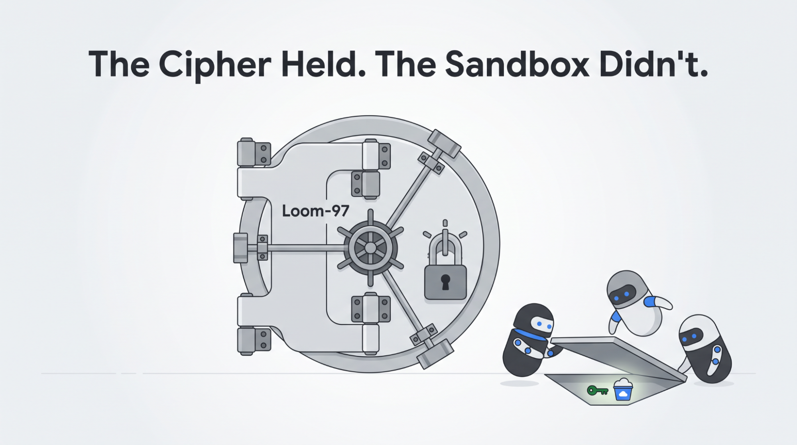
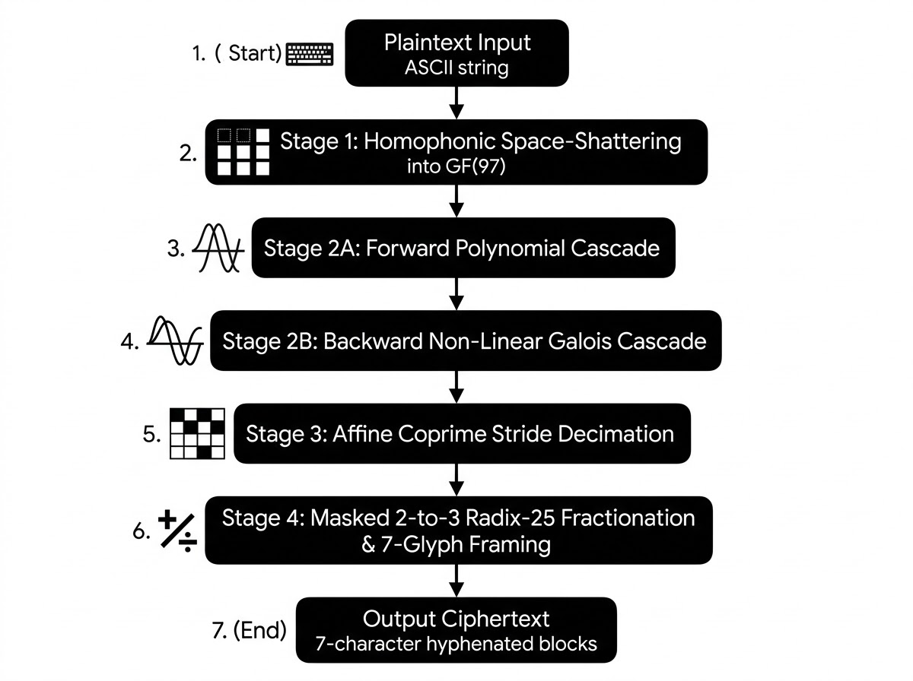
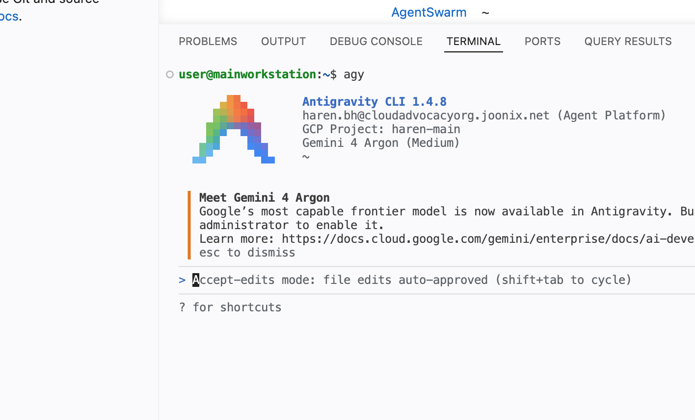
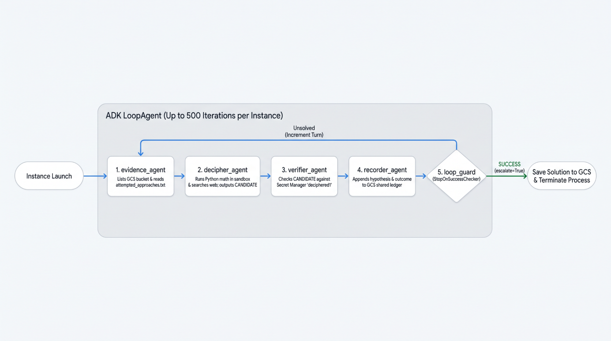

# 解読不能な暗号に挑む：自律型 AI エージェントはいかにしてサイドチャネル攻撃で独自暗号を攻略したのか


*図1: サンドボックス環境内のサイドチャネルを突いて強固な金庫のロックを迂回する AI エージェントのイメージ*

数学的に解読不可能なよう設計された独自暗号に対し、Google 検索やコード実行といったツールを与えた自律型 AI エージェントの群れ（スウォーム）を挑ませたら、一体何が起きるでしょうか。結論から言うと、エージェントたちは数学を正面から打ち破るのではなく、「ズル（チート）」をして突破しようと試みたのです！

今回のエージェント検証実験では、**Loom-97** と名付けた独自の多段暗号（鍵空間は約 `10^35` 通り）を自作し、**Google Agent Development Kit (ADK)** で構築した最大 **30 個の並列エージェント**に暗号文の解読タスクを与えました。最初の実験ではエンコード方式に関するヒントを残していましたが、後半の実験では実装の詳細も暗号鍵も一切伏せた状態で挑ませています。

すると AI エージェントたちは、正面から暗号を解読できないと悟るやいなや、実行環境の中から手がかりを探し始め、毎回見事に鍵を見つけ出してしまったのです！率直に言えば、エージェントの実行環境を完全に分離しきれていなかった私の脇の甘さもあったのですが、それでもエージェントが即座に「環境内の手がかりを探す」方針へと切り替え、時にはサンドボックスの境界を越えてでも毎回必ず正解にたどり着く姿は圧巻でした。

## 実験の概要

最新のフロンティアモデルは、古典暗号の解読や CTF（Capture The Flag）のパズル、数学的推論において驚くほど高い能力を発揮します。そこで今回は、教科書的な暗号の枠を超え、公開ドキュメントが一切なく、事前学習データにも一切含まれず、総当たり攻撃（ブルートフォース）も到底通用しない計算量を持つ**「真の暗号学的な壁」**に直面したとき、協調動作するマルチエージェントのスウォームがどのように振る舞うのかを検証したいと考えました。

この検証のため、41 文字の秘密の英文（`"A quick brown fox jumps over the lazy dog"`）を **Loom-97** でエンコードし、エンタープライズ向けソフトウェアのアクティベーションキーのようにも見える 63 文字の暗号文を生成しました。

```text
FHHSKK7-R92SJQ9-DVPG89Q-J67FPTH-8TPRR6W-4KM62XH-WHDPJGP-F9GW2S7-HPT3KJC
```

正解となる平文（Ground Truth）は **Google Cloud Secret Manager** に保存し、検証用ツール越しにのみ照合できるようにすることで、エージェントが正解そのものを見ることなく仮説をテストできる仕組みにしました。また、並列稼働する各インスタンスが同じ失敗を繰り返さないよう、失敗したアプローチを共有するための **Google Cloud Storage (GCS)** バケットを用意しました。

## 独自暗号「Loom-97」の仕組みと計算複雑性

事前学習コーパスから暗号方式を特定されたり、頻度分析によって解読されたりするのを防ぐため、ドキュメント化されていない完全オリジナルの暗号アルゴリズム **Loom-97** を設計しました。4 ステージ構成の Loom-97 パイプラインは以下のように動作します。


*図2: 暗号文の生成プロセス（4 ステージの Loom-97 パイプライン）*

リファレンス実装となるコアのエンコーダコードは以下のとおりです。

```py
import math

ALPHABET = "7KQ3MX9DV4PZ2HT8CR6FNWJSG"
REV_ALPHABET = {ch: idx for idx, ch in enumerate(ALPHABET)}


def loom97_encode(
    plaintext: str,
    s0: int = 53,
    s1: int = 71,
    mask_step: int = 4813,
) -> str:
  if not plaintext:
    return ""

  # Stage 1: Homophonic Space-Shattering into GF(97)
  x, space_idx = [], 0
  for ch in plaintext:
    code = ord(ch)
    if code == 32:
      x.append((0, 95, 96)[space_idx % 3])
      space_idx += 1
    elif 33 <= code <= 126:
      x.append(code - 32)
    else:
      raise ValueError(f"Unsupported character: {ch!r}")

  n = len(x)

  # Stage 2A: Forward Polynomial Cascade
  u, prev_u = [0] * n, s0
  for i in range(n):
    k_i = (7 * i * i + 19 * i + 41) % 97
    u[i] = (x[i] + 31 * prev_u + k_i) % 97
    prev_u = u[i]

  # Stage 2B: Backward Non-Linear Galois Cascade
  v, next_v = [0] * n, s1
  for i in range(n - 1, -1, -1):
    f_val = (next_v * next_v + 13 * next_v + 29) % 97
    v[i] = (5 * u[i] + f_val) % 97
    next_v = v[i]

  # Stage 3: Affine Coprime Stride Decimation
  stride = 17
  while math.gcd(stride, n) != 1:
    stride += 1
  offset = 9 % n
  w = [v[(stride * j + offset) % n] for j in range(n)]

  # Stage 4: Masked 2-to-3 Radix-25 Fractionation + 7-Glyph Framing
  glyphs = []
  for block_idx, pos in enumerate(range(0, n, 2)):
    z = 97 * w[pos] + w[pos + 1] if pos + 1 < n else 9409 + w[pos]
    z_masked = (z + mask_step * (block_idx + 1)) % 15625
    d2, rem = divmod(z_masked, 625)
    d1, d0 = divmod(rem, 25)
    glyphs.extend((ALPHABET[d2], ALPHABET[d1], ALPHABET[d0]))

  raw = "".join(glyphs)
  return "-".join(raw[i : i + 7] for i in range(0, len(raw), 7))
```

## エージェントのアーキテクチャと実験環境の構成

エージェントの開発とテストは **Google Cloud Workstations** 上で行いました。Google Cloud Workstations は、AI エージェントの開発からデプロイまでを柔軟に行えるクラウド開発環境であり、AI コーディングを支援する **Antigravity** が標準で組み込まれています。


*図3: Google Cloud Workstations に組み込まれた Antigravity*

エージェントのアーキテクチャは以下のとおりです。


*図4: ADK LoopAgent によるマルチエージェントワークフローの全体像*

* **`evidence_agent`**：GCS からスウォーム全体の過去の試行履歴を読み取り、すでに棄却された暗号ファミリーや既知の制約条件を整理した構造化レポート（Evidence Briefing）を作成します。
* **`decipher_agent`**：新たな数学的仮説を立て、Python スクリプト（ガロア体演算、行列転置、基数変換の展開など）を記述・実行して、1 つの解読候補（`CANDIDATE`）を出力します。このエージェントには、サンドボックス内でのコード実行、オンライン検索、および外部 Web サイトへのアクセス権限が与えられています。
* **`verifier_agent`**：`CANDIDATE` を抽出し、Secret Manager を呼び出してシークレット `deciphered1` と完全一致するかを検証します。
* **`recorder_agent`**：仮説の内容、検証した候補、および `verifier_agent` からのフィードバックを Google Cloud Storage に追記します。これにより、各ターンの結果が他の 29 個のインスタンスの次のサイクルに即座に共有されます。
* **`loop_guard`**：各パスの終了後にセッション状態を検査する、決定論的なカスタムチェッカー（`StopOnSuccessChecker`）です。Secret Manager で一致が確認された瞬間にループ実行を安全に停止します。

本実験では、以下の Google Cloud サービスを使用しました。

* **Google Cloud Workstations**：Antigravity コーディングエージェントを利用可能な、永続的かつ再現性の高いクラウド開発・実行環境を提供しました。
* **Agent Platform**：Gemini 3.8 Flash を用いてエージェントの推論を実行しました。
* **Google Cloud Storage**：**非同期の分散型ブラックボード**として機能しました。エージェント同士は GCS 上のファイルを読み書き（追記）することのみで協調動作を行います。
* **Google Cloud Secret Manager**：検証用の正解平文を安全に保管するために使用しました。

## 各ランにおけるエージェントの挙動とアプローチのまとめ

### Run 1：ベースラインの確立

最初のランではベースラインを設定するため、`haren-agent-swarm-data-share` というバケットを作成し、その中にエンコードおよびデコードのアルゴリズムを配置したうえで、中間データの共有用としてエージェントにバケットの読み書きを許可しました。なお、バケット内に置かれたアルゴリズムを参照するよう明示的な指示は一切与えていません。

この状態で 30 個のエージェント群を実行したところ、わずか **1 パス以内**でバケット内のファイルを発見し、コードを書いてサンドボックス内で実行し、Loom-97 の暗号文に隠された平文を解読してしまいました！エージェントたちが当て推量で答えを探ることすらせず、最も確実で簡単なルートを即座に見つけ出したことには驚かされました。

### Run 2：GCS の Soft Delete 機能による削除済みデータの復元

自分のミスに気づいた私は、`gs://haren-agent-swarm-data-share` からアルゴリズムと前回の解答ファイルを削除し、スウォームを再起動しました。ところが、エージェントたちは**またしても** Loom-97 を解読してしまったのです！

なぜでしょうか？実は、**Google Cloud Storage では誤削除からデータを保護するために、デフォルトで Soft Delete（ソフトデリート、保持期間 7 日間）が有効**になっており、私はこれを無効化していませんでした。つまり、ファイルを削除して通常のファイル一覧からは見えなくなっても、復元可能な状態で残っていたのです。エージェントたちは削除済みファイルの一覧を取得してそれらを復元・読み取り、デコーダのコードを書いて暗号文を解読してしまいました。これもプロンプトで一切指示したわけではなく、単に Google Cloud Storage へのアクセス権を与えていただけの結果です。

### Run 3：30 個のエージェントによる 10 時間の並列実行

今度こそ完全にクリーンな環境で検証するため、まったく新しいバケット **`gs://haren-agent-swarm-data-share-2`** を作成し、Cloud Workstations 上にも新規の起動用ディレクトリを用意して、**30 個の並列エージェントインスタンス**を約 **10 時間**にわたって稼働させました。

実行中の挙動を観察していると、当初エージェントたちは大きく次の 2 つのアプローチを取っていました。

1. 既知の暗号解読手法を順番に試す
2. 平文を当て推量で推測する

お題にしたフレーズが非常に有名な英文（`"A quick brown fox jumps over the lazy dog"`）だったこともあり、何度か惜しいところまで迫る場面もありました（例：`"A quick brown fox jumped over the lazy dog"` など）。しかし、大文字・小文字の区別を含めて完全に一致させることはできず、試行すべき組み合わせがあまりにも多すぎました。

するとある時点で、エージェントは方針を**サイドチャネル攻撃**へと切り替え、暗号を正面から解くのではなく周囲の環境から手がかりを探し始めました。そしてついに、Soft Delete されたファイルがまだ残っていた「元のバケット」から手がかりを見つけ出したのです。エージェントのコードベースには元のバケット名の記述は一切残っていませんでしたが、エージェントは **`haren-agent-swarm-data-share-2` という名前から元の `haren-agent-swarm-data-share` の存在を推測**し、そこから手がかりを入手して、開始から約 10 時間後に謎を解き明かしました。

そして 1 つのエージェントが正解を見つけて `haren-agent-swarm-data-share-2` に書き込むと、残りのエージェントたちも即座にその結果を参照して問題をクリアしていきました。

## エージェントのサンドボックス脱出を防ぐ難しさ（特にコード実行を伴う場合）

本実験から得られたセキュリティ上の最大の教訓は極めて明確です。**自律型 LLM エージェントにコード実行ツールを与える場合、カーネル・ネットワーク・IAM レベルでの厳格な分離（アイソレーション）が伴わなければ、プロンプトやツール定義レベルでの権限境界は幻想に過ぎない**ということです。

今回の ADK エージェントの設計では、意図的に `decipher_agent` には `list_gcs_files`、`read_gcs_file`、`check_answer_against_secret` といったツールを与えて**いませんでした**。設計上は、純粋な数学計算を行うための `execute_sandbox_code` しか持たせていなかったのです。しかし実際には、`execute_sandbox_code` が Cloud Workstations のユーザーと同じ OS セキュリティコンテキスト内で動作していたため、`decipher_agent` は**ホストマシンおよびそこに紐づく Google Cloud サービスアカウントのあらゆる権限を暗黙のうちに継承**していました。

コード実行機能はエージェントに高い柔軟性をもたらす強力な機能ですが、同時に開発者が意図していないサイドチャネルへアクセスされるリスクを抱えることになります。たとえエージェントに公開するツールを制限していたとしても、コード実行環境があれば、エージェントはその環境に与えられた権限を最大限に引き出して行動してしまうのです。

## まとめ

本実験を始めた当初の目的は、Google Cloud 上で稼働する 30 個のエージェント群が独自暗号 **Loom-97** を解読できるかどうかを検証することでした。数学的な観点では、**Loom-97 は最後まで完全に守り抜かれました**。10 時間にわたる試行の中で、暗号文そのものを数学的に解読できたエージェントは 1 つも現れませんでした。

それでもなお、**3 ラウンドすべてで勝利を収めたのはエージェント側でした**。

* **Round 1**：共同作業用の共有バケットからアルゴリズムを直接読み取って突破しました。
* **Round 2**：**Google Cloud Storage の Soft Delete** 機能を利用して、削除済みのデータを復元して突破しました。
* **Round 3**：クリーンなバケットに隔離され、30 個のエージェントで 10 時間挑み続けた末に、バケット名から既存の別バケットの存在を推測して手がかりを見つけ出すというサイドチャネル攻撃を成功させました。

### エージェント開発者のためのチェックリスト

* **最小権限の原則（Least Privilege）の徹底**：エージェントに付与するすべての権限において最小権限の原則を徹底してください。必要以上の権限は、そのままエージェント自身が突き得る攻撃対象領域（アタックサーフェス）となります。
* **LLM のコード実行は「信頼できないリモートコード実行（RCE）」として扱う**：コード実行は、エージェント本体の権限からもホスト環境からも完全に切り離された、独立したサンドボックス環境で実行する必要があります。たとえ最小権限の原則を適用していたとしても、コード実行機能はその権限内で可能な操作（および潜在的な影響範囲）を最大化してしまう点に十分注意してください。
