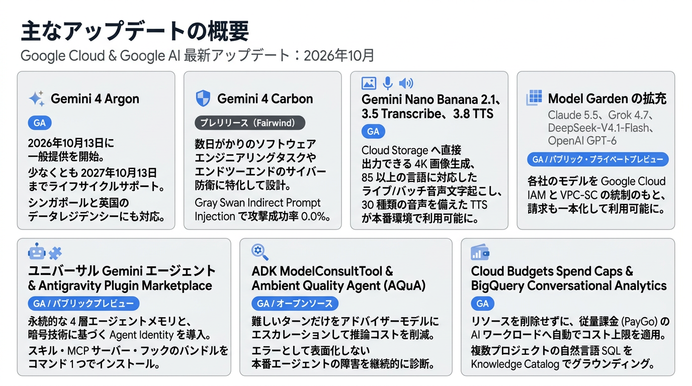
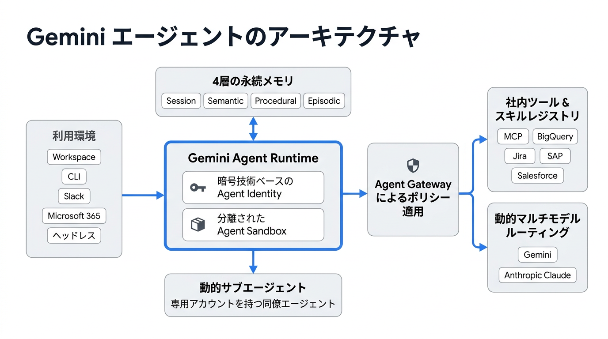
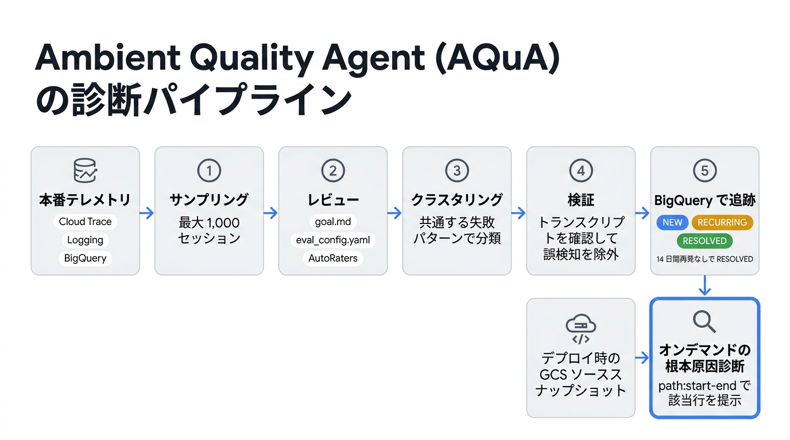

# Google Cloud & Google AI 最新アップデート：2026年10月

## はじめに

今日、本番環境向けの AI システムを構築するうえで向き合うべきエンジニアリング課題は、突き詰めると次の 3 つに集約されます。「長時間にわたる多段階のタスク（Long-Horizon Tasks）を通じて一貫した推論を維持すること」、「本番環境で稼働するマルチモデルエージェントのガバナンスを確保すること」、そして「クラウドコストとセキュリティ境界を予測・制御できる状態に保つこと」です。2026年10月には、こうしたボトルネックをそれぞれ解消するための機能を数多くリリースしました。その内容は、**Gemini 4 Carbon** の発表と **Gemini 4 Argon** の一般提供開始をはじめ、本番エージェントの処理に影響を与えずに行うアウトオブバンド（帯域外）診断、請求額に厳格な上限を設ける Spend Caps（支出上限）まで多岐にわたります。マルチエージェントのバックエンドを設計している方、プラットフォームのセキュリティを担当している方、推論コストの FinOps 最適化に取り組んでいる方など、どなたでも今すぐ活用できるアップデートをまとめてご紹介します。

---

## 主なアップデートの概要

| リリース / 機能 | 提供ステージ | 開発者にとってのポイント | ドキュメント / クイックスタート |
| :--- | :--- | :--- | :--- |
| **Gemini 4 Argon (`gemini-4-argon`)** | **GA** | 2026年10月13日に一般提供を開始。少なくとも2027年10月13日までライフサイクルサポートが提供され、シンガポールと英国のデータレジデンシーにも対応。 | [Gemini 4 Argon ドキュメント](https://docs.cloud.google.com/gemini-enterprise-agent-platform/models/gemini/4-argon) · [開発者ガイド](https://docs.cloud.google.com/gemini-enterprise-agent-platform/models/guides/gemini-4-argon) |
| **Gemini 4 Carbon** | **プレリリース (Fairwind)** | 数日がかりのソフトウェアエンジニアリングタスクや、エンドツーエンドのサイバー防衛に特化して設計。Gray Swan Indirect Prompt Injection ベンチマークで攻撃成功率 0.0% を達成。 | [Gemini 4 Carbon 発表記事](https://blog.google/innovation-and-ai/models-and-research/gemini-models/introducing-gemini-4-carbon/) |
| **Gemini Nano Banana 2.1、3.5 Transcribe、3.8 TTS** | **GA** | Cloud Storage URI へ直接出力できる 4K 画像生成、85 以上の言語に対応したライブ／バッチ音声文字起こし、30 種類の表現豊かな音声を備えた TTS が本番環境で利用可能に。 | [Nano Banana 2.1 ドキュメント](https://docs.cloud.google.com/gemini-enterprise-agent-platform/models/gemini/nano-banana-2-1) · [Transcribe ドキュメント](https://docs.cloud.google.com/gemini-enterprise-agent-platform/models/gemini/3-5-transcribe) · [TTS ドキュメント](https://docs.cloud.google.com/gemini-enterprise-agent-platform/models/text-to-speech/overview) |
| **Model Garden の拡充（Claude 5.5、Grok 4.7、DeepSeek-V4.1-Flash、OpenAI GPT-6）** | **GA / パブリック・プライベートプレビュー** | Gemini、Anthropic Claude 5.5、xAI Grok 4.7、DeepSeek-V4.1-Flash、OpenAI GPT-6 の各モデルを、Google Cloud IAM と VPC-SC による統制のもと、請求も一本化して利用可能に。 | [Claude 5.5 ドキュメント](https://docs.cloud.google.com/gemini-enterprise-agent-platform/models/partner-models/claude/opus-5-5) · [Grok 4.7 ドキュメント](https://docs.cloud.google.com/gemini-enterprise-agent-platform/models/partner-models/grok/grok-4-7) · [OpenAI ブログ](https://cloud.google.com/blog/products/ai-machine-learning/google-cloud-brings-openai-models-to-customers) |
| **ユニバーサル Gemini エージェント & Antigravity Plugin Marketplace** | **GA / パブリックプレビュー** | 永続的な 4 層エージェントメモリと、暗号技術に基づく Agent Identity を導入。スキル、MCP サーバー、フックをまとめたバンドルを `agy plugin install` コマンド 1 つでインストール可能に。 | [Gemini at Work 基調講演](https://cloud.google.com/blog/products/ai-machine-learning/welcome-to-gemini-at-work-2026) · [Antigravity 変更履歴](https://antigravity.google/docs/changelog) |
| **ADK `ModelConsultTool` & Ambient Quality Agent (AQuA)** | **GA / オープンソース** | 難しいターンだけをアドバイザーモデルにエスカレーションして推論コストを削減。さらに、`HTTP 200` を返したまま表面化しない本番エージェントの障害を、ソーススナップショットと照合して継続的に診断。 | [ADK Python リリース](https://github.com/google/adk-python/releases) · [AQuA リポジトリ](https://github.com/google/adk-recipes/tree/main/core/python/ambient-quality-agent) |
| **Cloud Budgets Spend Caps & BigQuery Conversational Analytics** | **GA** | リソースを削除することなく、従量課金（PayGo）の AI ワークロードに自動でコスト上限を適用。また、複数プロジェクトにまたがる自然言語 SQL を Knowledge Catalog のセマンティクスに基づいてグラウンディング。 | [Spend Caps ブログ](https://cloud.google.com/blog/topics/cost-management/google-cloud-spend-caps-now-generally-available) · [BigQuery リリースノート](https://docs.cloud.google.com/bigquery/docs/release-notes) |

---

## AI アップデート

### Gemini 4 Carbon（プレリリース）

2026年10月28日、**Gemini 4 Carbon**（**プレリリース**）を発表しました。数日がかりのソフトウェアエンジニアリングタスクとエンドツーエンドの防御的サイバーセキュリティ向けに設計されたフロンティアモデルで、主な特長は次のとおりです。

* **提供状況:** API、エンタープライズ、コンシューマー向けに広く提供されるのに先立ち、まずは米国政府によるプレリリーステストと、Fairwind プログラムで審査を通過したサイバー防衛担当者向けに先行して展開されています。
* **長期タスクと計画立案:** 数日単位の長期タスクに対応するアーキテクチャを採用しています。マルチステップの計画立案では、指示の範囲を超えた行動（Overreach）を 26%、対応漏れ（Under-service）を 29% 削減し、根拠のない主張をおよそ半分に抑えています（いずれも Gemini 4 Argon 比）。
* **知能・コーディング性能:** Artificial Analysis Intelligence Index v5.0 で **第1位**（**59**、2026年10月28日時点）、WebDev Arena で **第4位**（Elo **1768**）を獲得しました。Terminal-Bench 4.0 での不正行為（チート）の成功率は **0.0%** です。
* **サイバー防衛性能:** SEC-bench Pro で **88.2%**、ExploitGym で **54.8%**、CWE-bench で **71.0%** を記録しました。セキュアなコードを生成する能力も Gemini 4 Argon の **2 倍以上** に向上しています。
* **プロンプトインジェクション耐性:** Gray Swan Indirect Prompt Injection（IPI）での攻撃成功率は **0.0%** です。
* **料金:** 2026年11月30日までの導入記念価格は、入力 100 万トークンあたり **$2.00**、出力 100 万トークンあたり **$10.00**（キャッシュ済み入力は **95% オフ**）です。2026年12月1日からは標準価格（入力 **$4.00**、出力 **$20.00**／100 万トークンあたり）が適用されます。

**詳細はこちら:** [Gemini 4 Carbon の紹介](https://blog.google/innovation-and-ai/models-and-research/gemini-models/introducing-gemini-4-carbon/)

### Gemini 4 Argon の一般提供開始

**Gemini 4 Argon**（`gemini-4-argon`）は、2026年10月13日に一般提供（**GA**）を開始しました。ライフサイクルサポートは少なくとも2027年10月13日まで提供され、`us`・`eu` マルチリージョンに加えて、シンガポール（`asia-southeast1`）と英国（`europe-west2`）のデータレジデンシーにも対応しています。また、`gemini-4-argon-cyber-permissive` も Fairwind 許可リスト経由で **GA** となりました。

**詳細はこちら:** [Gemini 4 Argon の紹介（機能・料金の詳細）](https://blog.google/innovation-and-ai/models-and-research/gemini-models/introducing-gemini-4-argon/) | [Google Cloud ブログ](https://cloud.google.com/blog/products/ai-machine-learning/gemini-4-argon-available-on-google-cloud) | [Gemini 4 Argon ドキュメント](https://docs.cloud.google.com/gemini-enterprise-agent-platform/models/gemini/4-argon)

### 本番環境に対応したマルチモーダルメディア生成・音声処理・身体性推論

メディアや音声のパイプラインを構築する際は、ストレージへのアップロードジョブ、音声フォーマッタ、透かし（ウォーターマーク）ツールなどを個別につなぎ合わせる必要がよくあります。10月にリリースされた 4 つのモデルにより、クラウドストレージへのネイティブな保存、ストリーミング音声処理、空間推論を Gemini Enterprise Agent Platform 上で直接利用できるようになりました。

| モデル | 提供ステージ | エンドポイント・リージョン | 開発者向けのポイント・料金 | ドキュメント・ブログ |
| :--- | :--- | :--- | :--- | :--- |
| **Gemini Nano Banana 2.1** | **GA**（10月6日。Priority PayGo は10月14日、GCS URI 出力は10月26日から対応） | `gemini-nano-banana-2.1`（`global` Priority PayGo） | 14 種類のアスペクト比で 1K/2K/4K（16 MP）の画像を生成可能。131K トークンのコンテキスト、最大 14 枚の画像または 10 本の動画／1 件の YouTube URL の入力、C2PA コンテンツクレデンシャル、`outputConfig.outputUriPrefix` による Cloud Storage への直接保存に対応。画像出力のコストは Nano Banana 2 から 50% 削減（標準：100 万トークンあたり $30、Flex/Batch/オフピーク：100 万トークンあたり $15）。 | [Nano Banana 2.1 ドキュメント](https://docs.cloud.google.com/gemini-enterprise-agent-platform/models/gemini/nano-banana-2-1) · [リリースノート](https://docs.cloud.google.com/gemini-enterprise-agent-platform/release-notes) |
| **Gemini 3.5 Transcribe** | **GA** | `gemini-3.5-transcribe`（同期）、`gemini-3.5-transcribe-live`（Live API）。リージョン：`us`、`eu` | 85 以上の言語をサポートし、セッション途中で言語が切り替わるコードミキシングにも対応。最大 1,000 語句のカスタム語彙によるバイアス調整、CMEK、VPC-SC、Access Transparency（AXT）、**試験運用版（Experimental）** のスマートディクテーション／フォーマット機能を提供。料金は同期版が 1 分あたり約 $0.0051（100 万トークンあたり $2/$12）、ライブ版が 1 分あたり約 $0.0089（100 万トークンあたり $3.50/$21）。 | [Gemini 3.5 Transcribe ドキュメント](https://docs.cloud.google.com/gemini-enterprise-agent-platform/models/gemini/3-5-transcribe) |
| **Gemini 3.8 Text-to-Speech** | **GA**（10月26日。Voice Design & Replication は **パブリックプレビュー**） | `gemini-3.8-flash-tts`、`gemini-3.8-flash-lite-tts`（`global`、`us`、`eu`） | 70 以上の言語と 30 種類のスタジオ品質の音声を備え、複数話者の対話を 1 回の処理（シングルパス）で生成可能。構造化された「Director's Notes（演出ノート）」、インライン Audio Tags（`[whisper]`、`[sigh]`、`[laughing]`、`[short pause]`）、ストリーミング出力、SynthID による透かしにも対応。 | [Gemini 3.8 TTS ブログ](https://blog.google/innovation-and-ai/models-and-research/gemini-models/gemini-3-8-text-to-speech/) · [TTS ドキュメント](https://docs.cloud.google.com/gemini-enterprise-agent-platform/models/text-to-speech/overview) |
| **Gemini Robotics ER 2** | **パブリックプレビュー**（10月27日） | `gemini-robotics-er-2-preview` | Gemini 3.5 Flash をベースに構築された、身体性推論（Embodied Reasoning）向けの VLM。3D 空間推論、エージェント型のコード実行、動画理解、ロボティクスタスクのオーケストレーションに対応。 | [Robotics ER 2 ブログ](https://cloud.google.com/blog/products/ai-machine-learning/gemini-robotics-embodied-reasoning-2-is-now-available-on-google-cloud) |

**詳細はこちら:** [Agent Platform の料金](https://cloud.google.com/gemini-enterprise-agent-platform/generative-ai/pricing) | [Google Cloud 全体のリリースノート](https://docs.cloud.google.com/release-notes)

### Model Garden で広がるマルチモデルの選択肢

現代のエージェントアーキテクチャでは、単一のモデルファミリーだけに頼ることはほとんどありません。IAM や VPC 境界、クラウド費用のコミットメント契約を分断することなく、プランナーには最先端のフロンティアモデルを、サブエージェントには低コストなモデルを使い分けたいというニーズがあります。10月には Model Garden を拡充し、Gemini、Anthropic Claude、OpenAI GPT、xAI Grok、DeepSeek を統一されたガバナンスのもとで利用できるようにしました。

| パートナー / オープンモデルファミリー | 提供ステージ | モデル ID・デプロイ | 主な機能・エンタープライズ統合 | ドキュメント・発表記事 |
| :--- | :--- | :--- | :--- | :--- |
| **Anthropic Claude 5.5 ファミリー** | **GA**（10月7日〜15日。Anthropic-Managed は10月23日に **GA**） | `claude-opus-5-5`、`claude-sonnet-5-5`、`claude-haiku-5-5`（`global`、`us`、`eu`） | Model Garden、Antigravity 2.0/CLI/IDE（思考レベル `Low`〜`Max`）、Gemini Enterprise で利用可能。**Anthropic-Managed オプション**（**GA**）では、Google Cloud の IAM、監査ログ（Audit Logging）、Marketplace 経由でのコミットメント消化をそのまま活用しながら、Claude Platform の新機能（Managed Agents ベータ、スキル、コード実行）をリリース当日から利用可能。 | [Claude 提供拡大ブログ](https://cloud.google.com/blog/products/ai-machine-learning/expanding-claude-availability-on-google-cloud) · [Opus 5.5](https://docs.cloud.google.com/gemini-enterprise-agent-platform/models/partner-models/claude/opus-5-5) · [Sonnet 5.5](https://docs.cloud.google.com/gemini-enterprise-agent-platform/models/partner-models/claude/sonnet-5-5) · [Haiku 5.5](https://docs.cloud.google.com/gemini-enterprise-agent-platform/models/partner-models/claude/haiku-5-5) · [Anthropic-Managed ドキュメント](https://docs.cloud.google.com/gemini-enterprise-agent-platform/models/partner-models/claude/anthropic-managed) |
| **xAI Grok 4.7** | **GA**（10月27日） | `grok-4.7`（`global`、`us`） | テキスト／画像入力、推論、関数呼び出し（Function Calling）、構造化出力、**524,288 トークン** のコンテキストウィンドウに対応。OpenAI Responses API や Chat Completions とのネイティブ互換性も確保。 | [Grok 4.7 ドキュメント](https://docs.cloud.google.com/gemini-enterprise-agent-platform/models/partner-models/grok/grok-4-7) · [リリースノート](https://docs.cloud.google.com/gemini-enterprise-agent-platform/release-notes) |
| **DeepSeek-V4.1-Flash** | **パブリックプレビュー**（10月14日） | `deepseek-v4.1-flash-maas`（`global`、Standard PayGo） | 552B パラメータのマルチモーダル MoE をマネージドで提供（プレフィル時にトークンあたり 8B のバックボーンパラメータがアクティブ）。テキスト／画像入力、思考（Thinking）、ツール呼び出し、構造化出力に対応し、コンテキスト長・出力上限はいずれも **1,048,576 トークン**。 | [DeepSeek-V4.1-Flash ドキュメント](https://docs.cloud.google.com/gemini-enterprise-agent-platform/models/maas/deepseek/deepseek-v41-flash) |
| **OpenAI GPT-6 ファミリー** | **プライベートプレビュー**（10月21日発表） | **GPT-6 Astra**、**GPT-6.1 Sol**、**GPT-6 Luna** | Google Cloud の IAM、データ境界、Marketplace による請求の一本化、Flexible Savings Plan（FSP）の消化に対応した形で、Model Garden からネイティブに利用可能。法人向け Gemini および Antigravity との統合も近日提供予定。 | [OpenAI on Google Cloud ブログ](https://cloud.google.com/blog/products/ai-machine-learning/google-cloud-brings-openai-models-to-customers) |

### ファインチューニングと AI コンテンツの来歴証明

* **Gemini 3 向け教師ありファインチューニング（SFT）（GA、10月19日）:** `us` および `eu` マルチリージョンのエンドポイントで **GA** となり、チューニングジョブとチューニング済みエンドポイントの両方で顧客管理の暗号鍵（**CMEK**）を利用できるようになりました。対象モデルには、`gemini-3.5-flash` と `gemini-3.1-flash-lite` に加えて `gemini-3.5-flash-lite` が新たに追加されています（[Agent Platform リリースノート](https://docs.cloud.google.com/gemini-enterprise-agent-platform/release-notes)）。
* **SynthID Detector のグローバル展開（GA、10月7日・29日）:** 英語版が全世界で利用可能になり、Google のモデルだけでなく、**OpenAI、NVIDIA、Kakao、Apple** などパートナー各社のモデルで生成された画像・動画・音声についても、AI 生成かどうかを誰でも検証できるようになりました。これまでに透かしが埋め込まれた画像・動画は 1,800 億点以上、音声は 24 万年分に上り、Google 検索、Chrome、Gemini アプリ全体で 1 日あたり 100 万回以上の検証が行われています（[Google DeepMind SynthID ブログ](https://blog.google/innovation-and-ai/models-and-research/google-deepmind/synth-id-ai-content/)）。

### モデルライフサイクルの主要な日程

本番環境のエンドポイントを常に最新の状態に保てるよう、以下のモデルライフサイクルの主要な日程をご確認ください。

| モデル / ファミリー | ライフサイクルステージ・主要日程 | 開発者が取るべき対応 / 移行パス |
| :--- | :--- | :--- |
| **`gemini-3.8-flash`** | **GA**（少なくとも2027年9月2日までサポート） | 保存データのデータレジデンシー（DRZ）と国内 ML 処理に対応した提供形態が、**シンガポール (`sg`)**（10月8日）と **英国 (`europe-west2`)**（10月14日）で **GA** に。 |
| **Gemini 2.5 ファミリー**（`gemini-2.5-pro`、`gemini-2.5-flash`、`gemini-2.5-flash-lite`） | **提供終了（Retired）**（2026年10月20日） | API トラフィックを Gemini 3.8 または Gemini 4 モデルへ移行してください。カナダおよび日本の国内リージョンで利用されている Gemini Enterprise のセッションは、`gemini-3.5-flash` へ自動的に移行済みです。 |
| **`gemini-3.6-flash`** | **非推奨・提供終了予定**（2026年11月19日） | 2026年11月19日までに、エンドポイントを `gemini-3.8-flash` へアップグレードしてください。 |
| **`gemini-3.7-flash`** | **非推奨・提供終了予定**（2027年1月28日） | 2027年1月28日までに、エンドポイントを `gemini-3.8-flash` へアップグレードしてください。 |

**詳細はこちら:** [Gemini モデルライフサイクルドキュメント](https://docs.cloud.google.com/gemini-enterprise-agent-platform/models/model-versions) | [Gemini Enterprise リリースノート](https://docs.cloud.google.com/gemini/enterprise/docs/release-notes)

---

## エージェント関連アップデート

### ユニバーサル Gemini エージェントと業界特化型エージェント

2026年10月8日の Gemini at Work で発表された **Gemini エージェント** は、エンタープライズ向けの Q&A、ディープリサーチ、マルチモーダルなコンテンツ制作、自律的なコード実行を、単一のエージェントアーキテクチャと API に統合したものです。独自のメモリストアやプロキシゲートウェイをチームがゼロから構築しなくても、Workspace、Microsoft 365、Slack、モバイル／デスクトップ、CLI、ヘッドレス環境のすべてで、状態管理、ID、ポリシー適用の機能を標準で利用できます。

* **4 層のクラウドメモリ:** **セッション**（Session）、**意味記憶**（Semantic：社内ナレッジ）、**手続き記憶**（Procedural：学習したスキルや自ら作成したスキル）、**エピソード記憶**（Episodic）の 4 層のメモリを、複数のデバイスや数日間にわたる実行をまたいで保持します。
* **サブエージェントと同僚エージェント（Coworker Agents）:** タスクに応じてサブエージェントを並列または順次起動できます。さらに、専用の Workspace アカウント（`@agents.company.com`）、ドライブやカレンダーへのアクセス権、最小権限の IAM が割り当てられた常設の **同僚エージェント** もサポートしています。
* **業界特化型エージェント（パブリックプレビュー）:** **金融サービス** 向けと **法務** 向けの特化型エージェントを提供します。金融サービス向けエージェントは、FactSet、LSEG、SEC 提出書類に加え、10月30日に **パブリックプレビュー** となった S&P Global Adaptive Retrieval データストア（完全な監査リネージ付き）にグラウンディングされた 50 以上のスキルを備えています。法務向けエージェントは、NetDocuments や iManage で設定された案件（マター）単位の権限と情報隔壁（Ethical Walls）をそのまま継承します。

**詳細はこちら:** [Gemini at Work（Google ブログ）](https://blog.google/innovation-and-ai/infrastructure-and-cloud/google-cloud/gemini-at-work/) | [Gemini at Work 2026 基調講演ブログ](https://cloud.google.com/blog/products/ai-machine-learning/welcome-to-gemini-at-work-2026)

### Antigravity Plugin Marketplace、Enterprise Gateway、機能の利用制御

これまで、エンジニアリング組織全体でコーディングエージェントの環境を整えるには、開発者一人ひとりの PC で MCP の設定、プロンプトルール、認証情報を手作業で同期する必要がありました。**Antigravity v2.28.2**（2026年10月29日に **GA**）では、新しい **Plugin Marketplace**（`Main Screen → Customizations`）と CLI により、エージェントのカスタマイズ一式をパッケージ化し、コマンド 1 つでインストールできるようになりました。

* **`plugin.json` の 5 つの構成要素:** **Skills**（必要に応じて段階的に読み込まれる `SKILL.md`）、**MCP Servers**（OAuth 2.0 に対応した Streamable HTTP またはローカルの `stdio` で接続する `mcp.json`）、**Rules**（`rules/*.md`）、**Lifecycle Hooks**（`SessionStart`、`PreToolUse`、`PostToolUse`、`PreInvocation`、`PostInvocation`、`Stop` の各イベントに対応する `hooks.json`）、**Custom Agents**（`agents/*.md`）を 1 つのプラグインにまとめられます。
* **リリース時点の厳選カタログ:** **16 個の Google 製プラグイン** に加え、Atlassian、Canva、CrowdStrike、Databricks、Datadog、Dropbox、Figma、Linear、monday.com、Notion、Ping Identity、SentinelOne、Stripe、Supabase、Unity、Vercel の審査済みパートナープラグインを提供します。各サービスの認証は `Accounts` タブで一元管理できます。
* **Enterprise Gateway（GA、10月20日）と管理者向けの切り替え設定（GA、10月6日）:** プラットフォームチームは、Antigravity アプリ、CLI、IDE からの推論リクエストを一元管理の API キーゲートウェイ経由でルーティングし、トラフィックの検査やエグレス（外向き通信）の制御を行えます。推論の利用料はサービスアカウントの従量課金（PAYG）で請求されます。また、**Boost**（`/boost`、**GA**）と **Teamwork**（`/teamwork-preview`、**パブリックプレビュー**）の利用可否を組織単位で切り替えることもできます（[Gemini Enterprise リリースノート](https://docs.cloud.google.com/gemini/enterprise/docs/release-notes)）。

**詳細はこちら:** [Antigravity Plugin Marketplace ブログ](https://antigravity.google/blog/plugin-marketplace-in-antigravity) | [Antigravity 変更履歴](https://antigravity.google/docs/changelog)

### ADK for Python：`ModelConsultTool`、Deferred Scheduling、AQuA

エージェントのターンの大半は定型的なツール呼び出しで、重要なアーキテクチャ判断やポリシー判断が求められるのは、そのうちの 1〜2 回程度にすぎません。さらに、デプロイ後に気づきにくいロジックのリグレッションが発生しても、レスポンスは `HTTP 200 OK` を返し続けてしまいます。10月に Agent Development Kit（ADK）と `agents-cli` に加えられた 3 つのアップデートは、コスト効率の改善と、本番環境における品質の継続的な維持という 2 つの課題に対応します。

* **`ModelConsultTool`（`adk-python` v2.11.0〜v2.13.0、GA / オープンソース）:** 高速なメインの実行エージェントが、難しい推論ステップだけをターンの途中でツールを持たないアドバイザーモデルにエスカレーション（相談）できるようにします。相談回数は `max_uses` と `session_max_uses` で厳密に制限でき、`ForceEscalationPlugin` やトークン数・コストのテレメトリとも連携します（[ADK Python リリース](https://github.com/google/adk-python/releases) | [`ModelConsultTool` ガイド](https://github.com/google/adk-python/blob/main/docs/guides/tools/model_consult/model_consult_tool/index.md)）。
* **Deferred Scheduling（パブリックプレビュー）:** `service_tier="deferred"` を設定すると、レイテンシ要件が厳しくないバックグラウンドのエージェント処理をキューに入れ、オフピーク時間帯の空きキャパシティで実行できます。これにより **トークン料金が 50% 割引** になるほか、HTTP `429`（レート制限）エラーも減らせます（[Agent Platform リリースノート](https://docs.cloud.google.com/gemini-enterprise-agent-platform/release-notes)）。
* **Ambient Quality Agent — AQuA（オープンソース、10月8日）:** 本番エージェントとは別に（アウトオブバンドで）並行稼働し、Cloud Trace、Cloud Logging、BigQuery から 1 回の実行で最大 1,000 セッションを収集・分析します。`goal.md`、`eval_config.yaml`、Gemini AutoRaters（`task_success`、`tool_use_quality`、`trajectory_quality`）に基づいてトラジェクトリ（実行軌跡）を採点し、デプロイ時に Cloud Storage へ保存したソースコードのスナップショットから、問題箇所を正確な行番号（`<path>:<start>-<end>`）付きで示します（[AQuA ブログ記事](https://developers.googleblog.com/the-outer-loop-insights-first-an-ambient-quality-agent-that-diagnoses-your-production-agent/) | [AQuA GitHub リポジトリ](https://github.com/google/adk-recipes/tree/main/core/python/ambient-quality-agent) | [エージェント評価ドキュメント](https://docs.cloud.google.com/gemini-enterprise-agent-platform/optimize/evaluation/agent-evaluation)）。

### エージェントランタイム、コネクタ、ガバナンスに関するトピック

* **Computer Use Tool（GA、10月30日）:** **GA** に昇格しました。金融取引に関わる操作など機密性の高いアクションに対して、Human-in-the-Loop（HITL）による確認ポリシーを設定できるほか、`configurableComputerUseToolSafetyPolicies` で組織全体に制約を適用することもできます（[Agent Platform リリースノート](https://docs.cloud.google.com/gemini-enterprise-agent-platform/release-notes)）。
* **マルチプロバイダー対応のセマンティックガバナンスポリシー（GA、10月26日）:** Anthropic Messages/Claude API、OpenAI Chat Completions、Mistral AI、Llama/OpenAI 互換エンドポイント、セルフホスト型の vLLM など、Gemini 以外のモデルで動作するエージェントのツール呼び出しも、`sgpUserIntentMatching` による制御のもとで評価できるようになりました（[Agent Platform リリースノート](https://docs.cloud.google.com/gemini-enterprise-agent-platform/release-notes)）。
* **カスタム MCP の VPC 接続と引用表示（GA、10月16日・27日）:** プライベート MCP サーバーに接続するための Agent Gateway（`us-central1`、`europe-west1`）経由の Private Service Connect（PSC）アタッチメント、Cloud NAT による静的エグレス IP、REST API の `citation_mappings` による引用元チップの表示が追加されました（[Gemini Enterprise リリースノート](https://docs.cloud.google.com/gemini/enterprise/docs/release-notes)）。
* **Workflow Builder コネクタ（GA、10月13日・16日）:** **Microsoft Teams、Notion、Salesforce、Confluence Data Center、Jira Data Center** とのネイティブなワークフロー統合が追加されました（[Gemini Enterprise リリースノート](https://docs.cloud.google.com/gemini/enterprise/docs/release-notes)）。
* **CodeMender v0.12.0〜v0.17.0（パブリックプレビュー、10月5日〜28日）:** 6 回の CLI リリースを通じて、`--deep` 脆弱性スキャンのデフォルト並列実行、`cm health` による事前チェック、`cm support-bundle`、GitHub Code Scanning 向け SARIF 2.1.0 出力の更新、`.git/hooks` と `.codemender` を読み取り専用にするサンドボックス保護、C++ ファイルや shebang 付きスクリプトの自動検出、CI/CD 向けの `--plain` / `--jsonl` 出力が追加されました（[Agent Platform リリースノート](https://docs.cloud.google.com/gemini-enterprise-agent-platform/release-notes)）。

---

## Google Cloud 全般のアップデート

### Agentic Data Cloud と BigQuery Conversational Analytics

エージェントから業務データベースや分析データベースを利用する際に、ETL でデータを複製したり、根拠のない SQL を生成するハルシネーションのリスクを抱えたりするのは避けたいところです。10月には、ゼロコピーの MCP データベースフェデレーションと、ガバナンスを効かせた **BigQuery Conversational Analytics** を組み合わせて提供を開始しました。

* **フェデレーション型 Data Cloud コネクタと Knowledge Catalog（パブリックプレビュー、10月2日）:** Gemini から **BigQuery、AlloyDB for PostgreSQL、Spanner、Cloud SQL** に対して、ユーザーごとの認証情報を使い、データを複製することなく（ゼロコピーで）その場で MCP クエリを実行できます。クエリは **Knowledge Catalog** のビジネス指標やスキーマに自動的にグラウンディングされます（[Gemini at Work 2026 基調講演ブログ](https://cloud.google.com/blog/products/ai-machine-learning/welcome-to-gemini-at-work-2026) | [Gemini Enterprise リリースノート](https://docs.cloud.google.com/gemini/enterprise/docs/release-notes)）。
* **BigQuery Conversational Analytics（GA、10月14日〜27日）:** Knowledge Catalog にグラウンディングされた、複数のプロジェクトやデータセットにまたがる自然言語での分析が **GA** となりました。あわせて、Gemini Enterprise へのワンクリックでのエージェント公開（10月14日）、回答の **PDF/CSV** エクスポート（10月15日）、**モントリオール (`northamerica-northeast1`)** と **トロント (`northamerica-northeast2`)** リージョンへの対応（10月16日）、BigQuery での **会話の監査ログ記録**（10月26日）、**コネクテッドシート（Connected Sheets）** での対話型分析（10月27日）も追加されています（[BigQuery リリースノート](https://docs.cloud.google.com/bigquery/docs/release-notes)）。

### Cloud FinOps、割り当てのガードレール、リージョン拡大

AI エンドポイントをプロトタイプの段階から全社規模のトラフィックに耐えられるまでスケールさせるには、厳格なコスト上限、リクエスト単位でのチャージバック（費用配賦）を可能にするテレメトリ、そして一部のユーザーが共有枠を使い切ってしまう「ノイジーネイバー」問題への対策が欠かせません。

* **Google Cloud Budgets Spend Caps（GA、10月30日）:** Cloud Billing Budgets API を使ってプログラムからコスト上限を適用でき、AI の推定コストに基づいてほぼリアルタイムに発動します。上限に達すると、基盤となるリソースを削除することなく従量課金（PayGo）／CUD のリクエストを停止しますが、Provisioned Throughput（プロビジョニング済みスループット）は稼働したままです。上限は毎月自動的にリセットされます（[Google Cloud Spend Caps ブログ](https://cloud.google.com/blog/topics/cost-management/google-cloud-spend-caps-now-generally-available)）。
* **推論リクエストのメタデータロギング（GA、10月30日）:** プロンプトの内容を含まない、リクエスト単位の Cloud Logging レコード（モデル、リージョン、トークン数、レイテンシ、ティア、エラーコード）を出力します。ダッシュボードでは 1 秒単位の粒度で確認でき、`x-goog-agent-platform-observability-label-` ヘッダーを付与すれば、SQL でコストの帰属先を集計してチャージバックに活用することもできます（[Agent Platform リリースノート](https://docs.cloud.google.com/gemini-enterprise-agent-platform/release-notes)）。
* **ユーザー単位の割り当て上限と割り当て超過時の PayGo（GA、10月6日〜7日・22日）:** 管理者は `Usage & Spending > Usage`（Standard、Plus、Standard Emerging Market）で、ユーザーごとの割り当て上限と倍率を設定できます。これにより、一部のパワーユーザーが共有プールを使い果たすのを防げます。あわせて、割り当て超過時の従量課金（PayGo）をティアごとに制御する機能が、Frontline、EDU、Emerging Market の各エディションにも拡大されました（[Gemini Enterprise リリースノート](https://docs.cloud.google.com/gemini/enterprise/docs/release-notes)）。
* **ブラジル (`br`) リージョン（許可リスト制で GA、10月28日）と Notebook の刷新（GA、10月30日）:** **ブラジル (`br`)** で国内データレジデンシー（DRZ）と国内での ML 処理の提供を開始しました。また、**Gemini Notebook Enterprise** の UI が刷新され、Audio Overview（音声概要）の言語の個別選択、インフォグラフィックのスタイルプレビュー、カスタム要約、Fast Research に対応しました（[Gemini Enterprise リリースノート](https://docs.cloud.google.com/gemini/enterprise/docs/release-notes)）。

### セキュリティ、IAM、ネットワーク境界に関するアップデート

* **IAM Workforce セッションの取り消し（GA、10月6日）と条件付き基本ロール（GA、10月29日）:** 管理者は `gcloud` または REST API を使って、Workforce Identity 連携のプリンシパルが持つアクティブなセッションと短期認証情報を即座に失効させられるようになりました。また、IAM Conditions に対応した条件付きの基本ロール（`roles/admin`、`roles/writer`、`roles/reader`）の付与も可能になりました（[IAM リリースノート](https://docs.cloud.google.com/iam/docs/release-notes) | [Workforce セッション取り消しドキュメント](https://docs.cloud.google.com/iam/docs/workforce-revoke-sessions)）。
* **VPC Service Controls の違反修正提案と GKE Workload Identity（パブリックプレビュー、10月8日・14日）:** Violation Analyzer が、最小権限のイングレス／エグレスルールやアクセスレベルの更新内容を自動で提案するようになりました（10月8日）。また、VPC-SC ポリシーから **GKE 用 Workload Identity 連携** のプリンシパルを、Kubernetes サービスアカウント、Namespace、クラスタの単位で直接参照することも可能になりました（10月14日）（[VPC Service Controls リリースノート](https://docs.cloud.google.com/vpc-service-controls/docs/release-notes)）。
* **Model Armor：データレジデンシーのデフォルト適用と組織ポリシー（GA）:** 新規作成または更新されるすべてのテンプレートに、`constraints/modelarmor.managed.requireTemplateDataResidencyCompliance` がデフォルトで適用されるようになりました（10月26日）。このほか、安全性フィルタとインジェクション対策の設定を必須化するカスタム組織ポリシー（**GA**、10月21日）、コンソール上でのテンプレートのテスト（**GA**、10月27日）、`us`/`eu` における Workspace 向けプロンプトインジェクションフィルタ `v3`（10月9日）が追加され、**ブラジル (`southamerica-east1`)** リージョンでも利用可能になりました（**GA**、10月29日）（[Model Armor リリースノート](https://docs.cloud.google.com/model-armor/release-notes)）。
* **サーバーレス環境での PHP の CVE パッチ自動適用（GA、10月21日〜23日）:** `CVE-2026-109618` および `CVE-2026-109619`（CVSS 9.2）に対応するため、App Engine スタンダード環境、Cloud Run、Cloud Run functions、Cloud Functions for Firebase に、パッチ適用済みの PHP `8.2.35`、`8.3.36`、`8.4.27`、`8.5.12` ベースイメージを自動的にロールアウトしました。あわせて、Cloud Armor のファイルアップロード／RFI 向けルールセットの更新と、23 件の Mandiant SecOps 検出ルール（`GLOBAL.26.015`）も提供されています（[Google Cloud セキュリティブログ](https://cloud.google.com/blog/products/identity-security/responding-to-core-php-vulnerabilities-cve-2026-109618-cve-2026-109619)）。
* **Google SecOps に関するトピック:** リージョンごとに SOAR `6.3.103`/`6.3.104` のアップデートを提供し、SOAR から Chronicle API への移行期限を2027年3月31日まで延長しました。また、キュレート済みの ATI ルールが `GTI_IOC` に移行されたほか（10月12日）、`Source Grouping Identifier` によるクローズ済みケースの再オープン（10月18日）、最大 50 件のケースを対象とした Investigation Management の一括操作（10月22日）、SIEM 検索を高速化する **Basic Mode**（**パブリックプレビュー**、10月31日）が追加されました（[SecOps リリースノート](https://docs.cloud.google.com/chronicle/docs/secops/release-notes) | [SOAR リリースノート](https://docs.cloud.google.com/chronicle/docs/soar/release-notes)）。

---

## 次のステップ

10月のリリースを、さっそくご自身の技術スタックに取り入れてみませんか？以下のリンクから、すぐに試すことができます。

1. **GA となった Gemini 4 Argon を本番環境で使う:** [Google Cloud コンソールの Agent Studio](https://console.cloud.google.com/agent-platform/studio/chat?model=gemini-4-argon) または [Google AI Studio](https://aistudio.google.com/) を開き、[Gemini 4 Argon 開発者ガイド](https://docs.cloud.google.com/gemini-enterprise-agent-platform/models/guides/gemini-4-argon) を参考に、既存のワークロードを Argon に切り替えて検証してみましょう。
2. **ADK エージェントを最適化・診断する:** [ADK Python リリース](https://github.com/google/adk-python/releases) を確認して `google-adk` をアップグレードし、`ModelConsultTool` を追加しましょう。あわせて、オープンソースの [Ambient Quality Agent (AQuA) レシピ](https://github.com/google/adk-recipes/tree/main/core/python/ambient-quality-agent) を本番エージェントと並行してデプロイしてみてください。
3. **Antigravity プラグインでコーディング環境を拡張する:** Antigravity を `v2.28.2` 以降にアップデートし、`Main Screen → Customizations` からプラグインを探すか、`agy plugin install` を実行してみてください。詳しくは [Antigravity の変更履歴とドキュメント](https://antigravity.google/docs/changelog) をご覧ください。
4. **AI の FinOps とセキュリティのガードレールを整備する:** [Google Cloud Spend Caps ガイド](https://cloud.google.com/blog/topics/cost-management/google-cloud-spend-caps-now-generally-available) を参考に、プログラムからコスト上限を設定しましょう。また、2026年11月19日の `gemini-3.6-flash` 提供終了に備えて、[Gemini モデルライフサイクルドキュメント](https://docs.cloud.google.com/gemini-enterprise-agent-platform/models/model-versions) を確認し、利用中のモデルエンドポイントを棚卸ししておきましょう。
