# Model Routing in Google Cloud using API Gateway

*Send one OpenAI-compatible request and let a managed gateway pick Gemini, Claude, or an OpenAI model in Model Garden. No proxy servers to run.*

Most production AI systems don't run on just one model anymore. You might plan with a frontier reasoning model, summarize with a fast, low-cost model, and keep a second provider as a fallback. But each provider has its own API. In practice, that choice ends up as SDK sprawl in your code, or as a self-hosted proxy that you have to run, scale, and secure.

In this post, I walk through **model routing in API Gateway** (**Public Preview**). It's a managed way to put one OpenAI-compatible endpoint in front of Gemini, Anthropic Claude, and OpenAI models in Model Garden. By the end, you'll have a gateway that does three things:

* `POST /v1/chat/gemini-claude` serves **Gemini 3.8 Flash** by default. It switches to **Claude Opus 4.7**, **Claude Sonnet 5**, or **Claude Haiku 4.5** when the request asks for one of them.
* `POST /v1/chat/maas-models` serves **OpenAI gpt-oss 120B** through the OpenAI-compatible MaaS endpoint.
* Every request needs an API key. Responses can stream, and every call is logged.

I build it three ways: in the **Google Cloud console**, with the **gcloud CLI**, and with **Antigravity CLI prompts**.

---

## 1. What is model routing, and why do you need it?

### The problem: many models, many APIs

On Gemini Enterprise Agent Platform (formerly Vertex AI), each model family has its own endpoint and request format:

| Model family | Endpoint on `aiplatform.googleapis.com` | Request format |
| :--- | :--- | :--- |
| Google Gemini | `…/publishers/google/models/MODEL:generateContent` | Gemini `generateContent` |
| Anthropic Claude | `…/publishers/anthropic/models/MODEL:rawPredict` | Anthropic Messages |
| OpenAI-compatible MaaS models, such as gpt-oss | `…/endpoints/openapi/chat/completions` | OpenAI Chat Completions |

If your application uses all three, it needs three code paths. Teams usually end up with one of two patterns:

* **SDK sprawl:** every app embeds several SDKs. Every model swap means a code change and a redeploy.
* **A self-hosted proxy such as LiteLLM:** clients get one API, but you now host, scale, patch, and secure one more service.

Either way, authentication, quotas, and logs end up spread across many places.

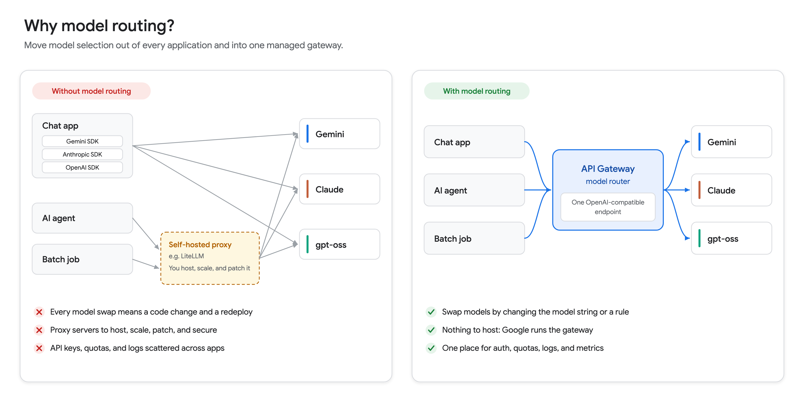

### What model routing is

[Model routing for API Gateway](https://docs.cloud.google.com/api-gateway/docs/model-routing-overview) is a managed traffic management layer. It accepts OpenAI-compatible prompt requests, translates them in flight, and routes them to specific models in Model Garden. The docs describe it as a managed alternative to client-side proxies such as LiteLLM. Routing happens at the network edge, and there are no proxy servers for you to run.

Model routing [launched in Public Preview on August 3, 2026](https://docs.cloud.google.com/api-gateway/docs/release-notes). During the preview, the router uses one signal to choose a model: the `model` attribute in the JSON body of an OpenAI-compatible request.

### Model routing architecture in Google Cloud

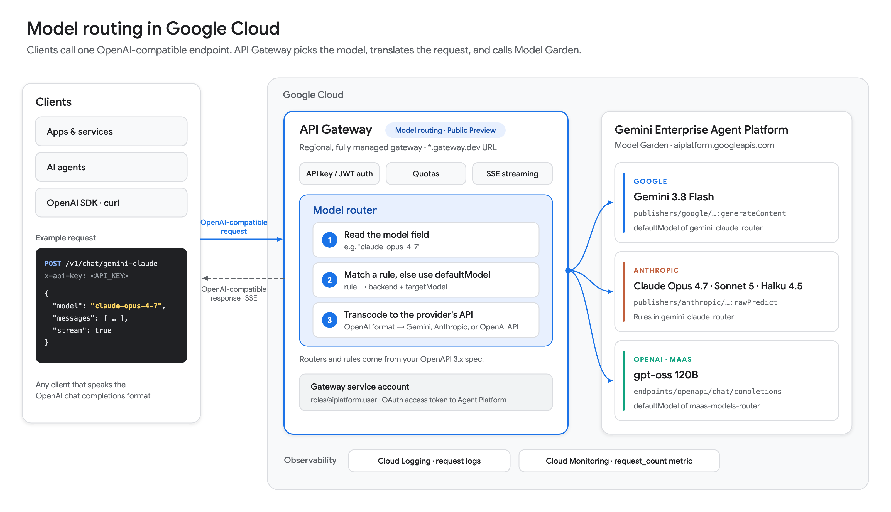

| Component | What it does |
| :--- | :--- |
| **Clients** | Apps, agents, and SDKs that send OpenAI-compatible chat completion requests. This is the only API your clients need to know. |
| **API Gateway** | A regional, fully managed gateway. It checks the caller's credentials (API key or JWT), enforces quotas, streams responses, and runs the model router. |
| **Model router** | Reads `model` and matches it against the rules in your OpenAPI 3.x spec, using `defaultModel` when no rule matches. Then it translates the request into the provider's API format. |
| **Gateway service account** | The identity the gateway uses to call Agent Platform. It needs only the Agent Platform User role (`roles/aiplatform.user`). |
| **Model Garden backends** | Gemini, Claude, and OpenAI-compatible MaaS endpoints on `aiplatform.googleapis.com`. All backends in one router must share the same hostname. |
| **Cloud Logging and Cloud Monitoring** | Request logs and the `request_count` metric for every routed call. |

### How a request flows

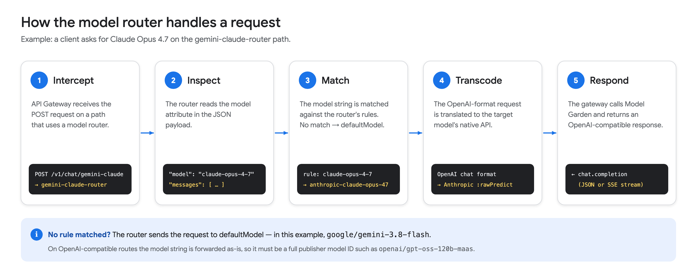

1. **Intercept:** the gateway receives the `POST` request on a path that has a model router attached.
2. **Inspect:** the router reads the `model` attribute, for example `"model": "claude-opus-4-7"`.
3. **Match:** the router compares that string with the router's rules. If no rule matches, it uses `defaultModel`.
4. **Transcode:** the gateway translates the OpenAI-format request into the target model's API, such as Anthropic `rawPredict`.
5. **Respond:** the gateway calls the Model Garden endpoint and returns an OpenAI-compatible response, either as JSON or as a server-sent events (SSE) stream.

### Why use it

| Benefit | What it means for you |
| :--- | :--- |
| **Centralized management** | Routing rules live in one OpenAPI spec, not in every app. |
| **No proxy to run** | You don't host, scale, patch, or secure LiteLLM-style servers. |
| **One client interface** | Clients use the OpenAI chat completions format for every model. |
| **Model swaps without code changes** | Change a rule in the spec or the `model` string in the request. The rest of the client code stays the same. |
| **Edge routing** | The gateway inspects and routes prompts at the network edge, with direct access to Model Garden endpoints. |
| **One place for governance** | Authentication, quotas, logs, and metrics are all at the gateway. |

The docs call out three groups who benefit:

* **Platform engineers**, who can replace client-side routing logic with managed infrastructure.
* **AI developers**, who get one endpoint that switches between models such as Gemini and Claude.
* **Governance admins**, who can enforce authentication and quotas and watch AI traffic across the organization.

---

## 2. Why model routing in Google Cloud?

A model router is only as useful as the models it can reach, and this is where Google Cloud stands out. When OpenAI models arrived in Model Garden, [Google Cloud announced](https://cloud.google.com/blog/products/ai-machine-learning/google-cloud-brings-openai-models-to-customers):

> "Google Cloud is now the only hyperscale cloud provider offering access to all three leading closed source LLMs, alongside more than 200 first-party, third-party, and open models on a unified enterprise AI platform."

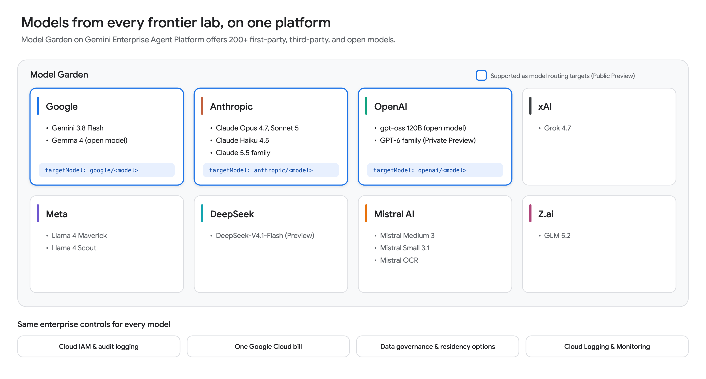

| Lab | Examples in Model Garden | Model routing target in Public Preview? |
| :--- | :--- | :--- |
| Google | Gemini 3.8 Flash, Gemma 4 | Yes, `google/…` |
| Anthropic | Claude Opus 4.7, Claude Sonnet 5, Claude Haiku 4.5, Claude 5.5 family | Yes, `anthropic/…` |
| OpenAI | gpt-oss 120B; GPT-6 family (**Private Preview**) | Yes, `openai/…` (documented with gpt-oss 120B) |
| xAI | Grok 4.7 | Not documented yet |
| Meta | Llama 4 Maverick, Llama 4 Scout | Not documented yet |
| DeepSeek | DeepSeek-V4.1-Flash (**Public Preview**) | Not documented yet |
| Mistral AI | Mistral Medium 3, Mistral Small 3.1, Mistral OCR | Not documented yet |
| Z.ai | GLM 5.2 | Not documented yet |

Here's why that matters for routing:

* **Models from every major lab in one catalog.** You can pick the best model for each task across Google, Anthropic, and OpenAI without signing separate vendor contracts.
* **One hostname.** Gemini, Claude, and gpt-oss are all served from the same global endpoint, `aiplatform.googleapis.com`. That fits the router's rule that all backends in a router share a hostname, so one router can reach both Gemini and Claude.
* **One identity.** The gateway calls every model with a single service account. You have no per-vendor API keys to store and rotate.
* **One bill.** Partner models such as Claude and OpenAI's models are billed through Google Cloud and can draw down eligible Google Cloud commitments.
* **One governance model.** The same IAM, audit logging, and monitoring apply whichever model serves the request.

> **Note:** In Public Preview, a router's `targetModel` provider must be `google`, `anthropic`, or `openai`. Check the [API Gateway release notes](https://docs.cloud.google.com/api-gateway/docs/release-notes) as support expands.

---

## 3. What is API Gateway?

[API Gateway](https://docs.cloud.google.com/api-gateway/docs/about-api-gateway) is a fully managed Google Cloud service that puts a consistent, secure REST API in front of your backend services. You describe the API in an OpenAPI spec, and API Gateway hosts it. It also handles authentication (API keys, Google ID tokens, and other JWTs), quotas, traffic management, logging, and monitoring.

Clients only see the API contract, so you can change the backend without changing the clients. That's exactly what you want when the backend is a fast-changing set of AI models.

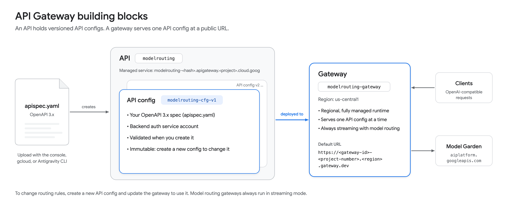

| Resource | What it is | In this post |
| :--- | :--- | :--- |
| **API** | A logical container for your API. Creating it also creates a *managed service* named `API_ID-HASH.apigateway.PROJECT_ID.cloud.goog`. | `modelrouting` |
| **API config** | An immutable snapshot of your OpenAPI spec plus the backend service account. API Gateway validates it when you create it. To change routing, create a new config. | `modelrouting-cfg-v1` |
| **Gateway** | A regional, fully managed runtime that serves one API config at a public URL. | `modelrouting-gateway` in `us-central1` |

API Gateway added several AI-focused features in 2026, all in **Public Preview**:

| Feature | Released | What it does |
| :--- | :--- | :--- |
| [Model routing](https://docs.cloud.google.com/api-gateway/docs/model-routing-overview) | Aug 3, 2026 | Routes OpenAI-compatible requests to models in Model Garden |
| [Model Context Protocol (MCP)](https://docs.cloud.google.com/api-gateway/docs/mcp-overview) | Sep 11, 2026 | Exposes existing REST APIs to agents as MCP tools |
| [Streaming gateways](https://docs.cloud.google.com/api-gateway/docs/streaming-configure) | Sep 29, 2026 | Streams traffic (SSE, chunked transfer, WebSockets, gRPC) instead of buffering it |

Model routing builds on API Gateway's OpenAPI 3.x support with three Google extensions:

* `x-google-api-management.backends` holds the named backend addresses.
* `x-google-api-management.ai.models.routing.routers` holds the named routers, each with a `defaultModel` and optional `rules`.
* `x-google-model-router` attaches a router to a `POST` operation.

A gateway that uses model routing always runs in streaming mode (`effectiveStreamingMode: EFFECTIVE_STREAMING_MODE_ENABLED`), so SSE responses work with no extra setup. You can't use MCP and model routing in the same API config.

---

## 4. How to configure model routing

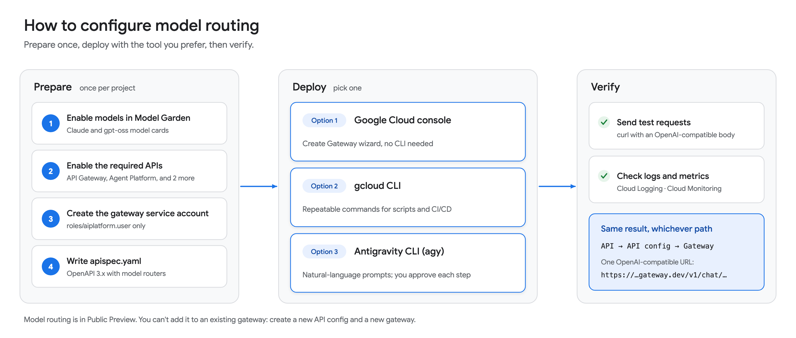

The setup has a one-time preparation phase, followed by deployment with whichever tool you prefer. All three options create the same three resources: an API, an API config, and a gateway.

### 4.1 Preparation

Set a few variables first. The gcloud commands and tests later in this post use them.

```bash
export PROJECT_ID="your-project-id"
export REGION="us-central1"
export API_ID="modelrouting"
export CONFIG_ID="modelrouting-cfg-v1"
export GATEWAY_ID="modelrouting-gateway"
export SA_NAME="model-router-sa"
export SA_EMAIL="${SA_NAME}@${PROJECT_ID}.iam.gserviceaccount.com"
export KEY_ID="model-router-client"

gcloud config set project "${PROJECT_ID}"
```

Make sure the right people and identities have these roles:

| Who | Role | Why |
| :--- | :--- | :--- |
| You | API Gateway Admin (`roles/apigateway.admin`) | Create APIs, API configs, and gateways |
| You | Service Account User (`roles/iam.serviceAccountUser`) on the gateway service account | Attach the service account to an API config (`iam.serviceAccounts.actAs`) |
| Whoever enables models | Consumer Procurement Entitlement Manager (`roles/consumerprocurement.entitlementManager`) | Enable partner and open models in Model Garden |
| Gateway service account | Agent Platform User (`roles/aiplatform.user`) | Call models on `aiplatform.googleapis.com` |

#### Step 1: Enable the models in Model Garden

You can call Gemini models as soon as the Agent Platform API is enabled. Partner models such as Claude and managed open models such as gpt-oss must first be enabled from their Model Garden model cards:

1. In the Google Cloud console, open **Model Garden** and search for the model.
2. Open the model card and click **Enable**, then accept the terms.
3. Repeat for each model that this post uses:

| Model | Model ID | Launch stage | Model card |
| :--- | :--- | :--- | :--- |
| Gemini 3.8 Flash | `gemini-3.8-flash` | GA | Available by default |
| Claude Opus 4.7 | `claude-opus-4-7` | GA | [Open model card](https://console.cloud.google.com/agent-platform/publishers/anthropic/model-garden/claude-opus-4-7) |
| Claude Sonnet 5 | `claude-sonnet-5` | GA | [Open model card](https://console.cloud.google.com/agent-platform/publishers/anthropic/model-garden/claude-sonnet-5) |
| Claude Haiku 4.5 | `claude-haiku-4-5` | GA | [Open model card](https://console.cloud.google.com/agent-platform/publishers/anthropic/model-garden/claude-haiku-4-5) |
| gpt-oss 120B | `gpt-oss-120b-maas` | GA | [Open model card](https://console.cloud.google.com/agent-platform/publishers/openai/model-garden/gpt-oss-120b-maas) |

All five models are available on the **global** endpoint, which the spec uses for every backend.

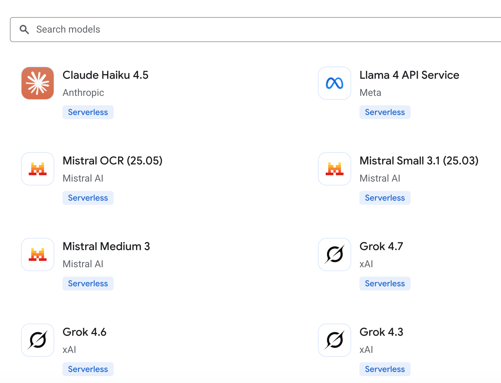

If you don't have permission to enable models, ask an administrator to grant you the entitlement role:

```bash
gcloud projects add-iam-policy-binding "${PROJECT_ID}" \
  --member="user:$(gcloud config get-value account)" \
  --role="roles/consumerprocurement.entitlementManager"
```

> **Note:** If your organization restricts which services can be used, the policy must allow `cloudcommerceconsumerprocurement.googleapis.com` before anyone can enable open models. See [Grant access to open models](https://docs.cloud.google.com/gemini-enterprise-agent-platform/models/maas/grant-access-open-models).

#### Step 2: Enable the required APIs

| API | Service name | Why |
| :--- | :--- | :--- |
| API Gateway API | `apigateway.googleapis.com` | Creates and runs gateways |
| Service Management API | `servicemanagement.googleapis.com` | Stores the managed service config for your API |
| Service Control API | `servicecontrol.googleapis.com` | Checks requests (auth, quotas, telemetry) at run time |
| Agent Platform API | `aiplatform.googleapis.com` | Serves the Model Garden endpoints |

In the console, go to **APIs & Services > Library**, search for each API, and click **Enable**. Or use one command:

```bash
gcloud services enable \
  apigateway.googleapis.com \
  servicemanagement.googleapis.com \
  servicecontrol.googleapis.com \
  aiplatform.googleapis.com
```

#### Step 3: Create a service account for the gateway

The gateway calls Agent Platform as a service account. Because model routing gateways run in streaming mode, the gateway sends an OAuth access token for this account to `*.googleapis.com` backends. As a best practice, create a dedicated service account and grant it only the Agent Platform User role. The Compute Engine default service account works too, but it often has much broader permissions than the gateway needs.

```bash
# Create a dedicated identity for the gateway
gcloud iam service-accounts create "${SA_NAME}" \
  --display-name="API Gateway model router"

# Let the gateway call models on Agent Platform, and nothing else
gcloud projects add-iam-policy-binding "${PROJECT_ID}" \
  --member="serviceAccount:${SA_EMAIL}" \
  --role="roles/aiplatform.user"

# Let your user attach this service account to an API config
gcloud iam service-accounts add-iam-policy-binding "${SA_EMAIL}" \
  --member="user:$(gcloud config get-value account)" \
  --role="roles/iam.serviceAccountUser"
```

In the console:

1. Go to **IAM & Admin > Service accounts** and click **Create service account**.
2. Name it `model-router-sa` and grant it the **Agent Platform User** role.
3. Open the new service account's **Permissions** tab and click **Grant access**.
4. Grant your user the **Service Account User** role.

#### Step 4: Write the OpenAPI 3.x spec

The spec is the heart of the setup, and all three deployment options use it. The diagram shows how its three parts connect: **paths** say what clients call, **routers** say how the model is chosen, and **backends** say where requests go.

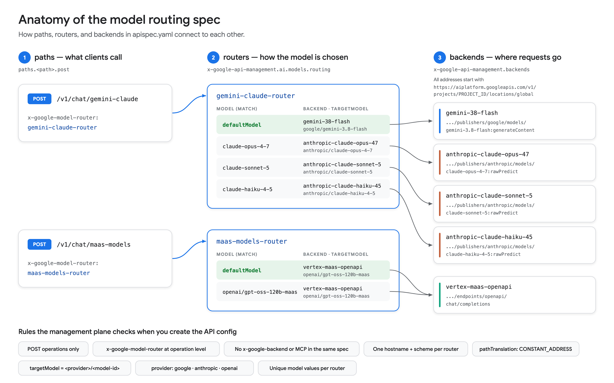

Save the following as `apispec.yaml`:

```yaml
openapi: 3.0.3

info:
  title: Model Routing API
  description: OpenAI-compatible model routing for Gemini, Claude, and gpt-oss
  version: 1.0.0

x-google-api-management:
  backends:
    # Google Gemini: native generateContent endpoint
    gemini-38-flash:
      address: "https://aiplatform.googleapis.com/v1/projects/PROJECT_ID/\
        locations/global/publishers/google/models/gemini-3.8-flash:generateContent"
      deadline: 60.0
      pathTranslation: CONSTANT_ADDRESS

    # Anthropic Claude: native rawPredict endpoints
    anthropic-claude-opus-47:
      address: "https://aiplatform.googleapis.com/v1/projects/PROJECT_ID/\
        locations/global/publishers/anthropic/models/claude-opus-4-7:rawPredict"
      deadline: 60.0
      pathTranslation: CONSTANT_ADDRESS

    anthropic-claude-sonnet-5:
      address: "https://aiplatform.googleapis.com/v1/projects/PROJECT_ID/\
        locations/global/publishers/anthropic/models/claude-sonnet-5:rawPredict"
      deadline: 60.0
      pathTranslation: CONSTANT_ADDRESS

    anthropic-claude-haiku-45:
      address: "https://aiplatform.googleapis.com/v1/projects/PROJECT_ID/\
        locations/global/publishers/anthropic/models/claude-haiku-4-5:rawPredict"
      deadline: 60.0
      pathTranslation: CONSTANT_ADDRESS

    # OpenAI-compatible Chat Completions endpoint for MaaS models
    vertex-maas-openapi:
      address: "https://aiplatform.googleapis.com/v1/projects/PROJECT_ID/\
        locations/global/endpoints/openapi/chat/completions"
      deadline: 60.0
      pathTranslation: CONSTANT_ADDRESS

  ai:
    models:
      routing:
        routers:
          # Gemini 3.8 Flash by default; Claude when the request asks for it
          gemini-claude-router:
            defaultModel:
              backend: gemini-38-flash
              targetModel: google/gemini-3.8-flash
            rules:
              - model: "claude-opus-4-7"
                backend: anthropic-claude-opus-47
                targetModel: anthropic/claude-opus-4-7
              - model: "claude-sonnet-5"
                backend: anthropic-claude-sonnet-5
                targetModel: anthropic/claude-sonnet-5
              - model: "claude-haiku-4-5"
                backend: anthropic-claude-haiku-45
                targetModel: anthropic/claude-haiku-4-5

          # OpenAI gpt-oss through the OpenAI-compatible MaaS endpoint
          maas-models-router:
            defaultModel:
              backend: vertex-maas-openapi
              targetModel: openai/gpt-oss-120b-maas
            rules:
              # OpenAI-compatible routes forward this string unchanged,
              # so it must be the full publisher model ID.
              - model: "openai/gpt-oss-120b-maas"
                backend: vertex-maas-openapi
                targetModel: openai/gpt-oss-120b-maas

# Require an API key in the x-api-key header on every operation
components:
  securitySchemes:
    api_key:
      type: apiKey
      name: x-api-key
      in: header

security:
  - api_key: []

paths:
  /v1/chat/gemini-claude:
    post:
      summary: "Gemini 3.8 Flash by default; Claude on request"
      operationId: chatGeminiClaude
      x-google-model-router: gemini-claude-router
      responses:
        "200":
          description: OK

  /v1/chat/maas-models:
    post:
      summary: "OpenAI gpt-oss through the OpenAI-compatible MaaS endpoint"
      operationId: chatMaasModels
      x-google-model-router: maas-models-router
      responses:
        "200":
          description: OK
```

Replace `PROJECT_ID` with your project ID. This command works with both GNU and BSD `sed`:

```bash
sed -i.bak "s/PROJECT_ID/${PROJECT_ID}/g" apispec.yaml
```

Here's what each part does:

| Field | Purpose |
| :--- | :--- |
| `backends.<name>.address` | The full Model Garden endpoint URL. Gemini uses `:generateContent`, Claude uses `:rawPredict`, and OpenAI-compatible models use `/endpoints/openapi/chat/completions`. |
| `pathTranslation: CONSTANT_ADDRESS` | Required for model routing backends. The gateway calls the address as written. |
| `deadline` | The number of seconds the gateway waits for the full response, including the whole stream. |
| `routers.<name>.defaultModel` | Required. The fallback when the request's `model` matches no rule. |
| `rules[].model` | The string matched against `model` in the request body. Values must be unique within a router, and `default` is reserved. |
| `rules[].targetModel` | `<provider>/<model-id>`, where the provider is `google`, `anthropic`, or `openai`. It selects the translation, and the gateway echoes it in the response's `model` field. |
| `x-google-model-router` | Attaches a router to an operation. It's allowed only on `POST` operations, set at the operation level. |
| `components.securitySchemes` and `security` | Require an API key on every call. Without them, anyone who knows the gateway URL can spend your model quota. |

A few rules catch most first-time errors:

* **One hostname and scheme per router.** Every backend that a router references must use the same host, such as the global `aiplatform.googleapis.com`. You can't mix the global endpoint and a regional one in the same router. API Gateway rejects the API config if you do.
* **No mixing.** A spec can't combine model-routing operations with `x-google-backend` operations, and it can't enable MCP. This is also rejected when you create the API config.
* **OpenAI-compatible rules need full IDs.** On `/endpoints/openapi/chat/completions` routes, the gateway forwards the rule's `model` string unchanged, so it must be a full publisher model ID such as `openai/gpt-oss-120b-maas`. This one isn't caught when you create the config. An alias such as `gpt-oss` deploys fine, then fails at request time with `400 Malformed publisher model`.

> **Tip:** The default `deadline` is only 15 seconds, and the limit applies to the whole stream. 60 seconds works for short prompts. For long reasoning or streaming responses, raise it (up to 3,600 seconds on streaming gateways).

I organized the routers by API surface: native Gemini and Claude endpoints in one router, and the OpenAI-compatible MaaS endpoint in another. Each path gets one clear default, and each router stays easy to reason about.

### 4.2 Option 1: Google Cloud console (web UI)

1. Go to [API Gateway](https://console.cloud.google.com/api-gateway/) in the Google Cloud console and click **Create Gateway**.

    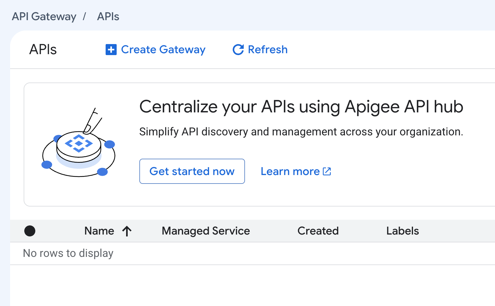

2. In the **API** section, select **Create new API**. Enter a display name (`ModelRouting`) and an API ID (`modelrouting`). The console previews the managed service name for the API.

    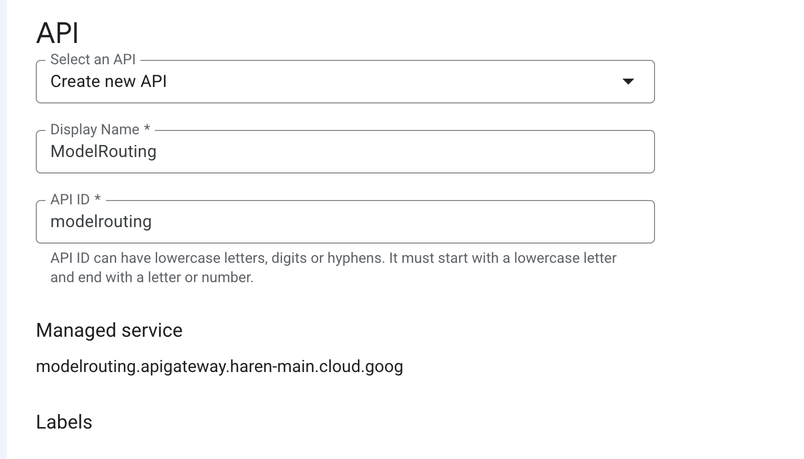

3. In the **API Config** section, select **Create new API config** and click **Browse** to upload `apispec.yaml`. Enter a display name. Under **Select a Service Account**, choose `model-router-sa`. The screenshot shows the Compute Engine default service account, which also works if it has `roles/aiplatform.user`.

    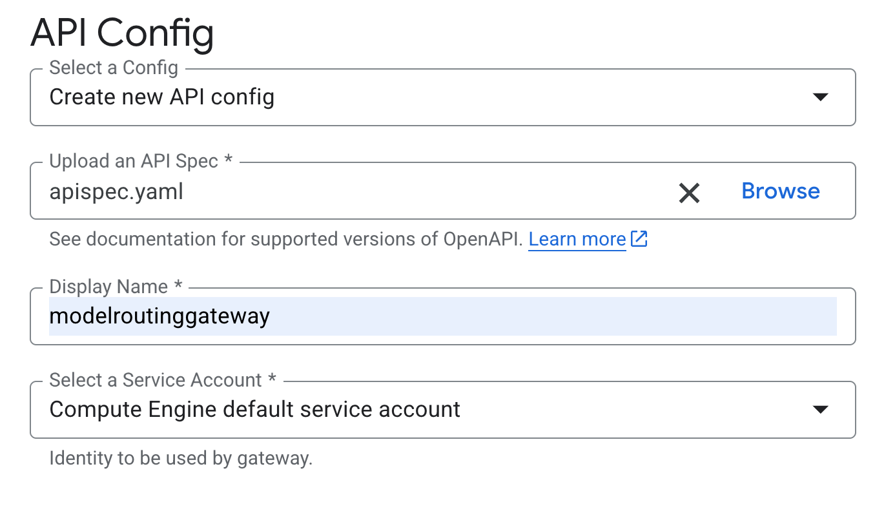

4. In **Gateway details**, enter a display name, choose the location `us-central1`, and click **Create gateway**.

    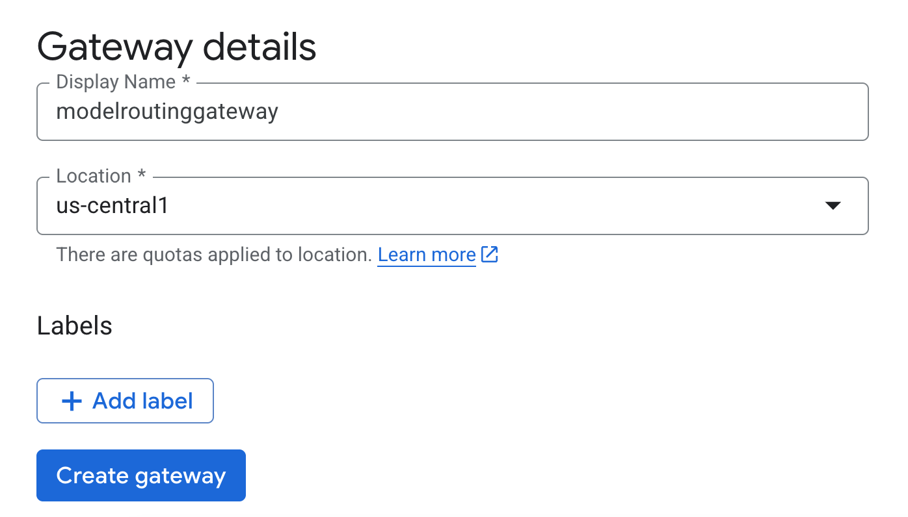

5. Creating the gateway takes a few minutes. When it finishes, the API appears in the list with its managed service name.

    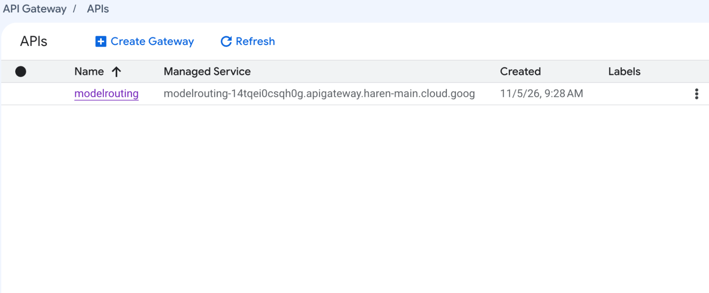

6. Click the API name, open the **Gateways** tab, and copy the gateway URL.
7. Turn on API key support. Go to **APIs & Services > Library**, search for the managed service name from step 5, and click **Enable**. A new managed service can take some time to appear in the Library.
8. Create a key. Go to **APIs & Services > Credentials** and click **Create credentials > API key**. Under **API restrictions**, select **Restrict key**, choose **Model Routing API** (the `info.title` from the spec), and click **Save**.

### 4.3 Option 2: gcloud CLI

Create the API, the API config, and the gateway:

```bash
# 1. Create the API (a logical container plus its managed service)
gcloud api-gateway apis create "${API_ID}" --display-name="ModelRouting"

# 2. Create an API config from the spec. API Gateway validates it here.
gcloud api-gateway api-configs create "${CONFIG_ID}" \
  --api="${API_ID}" \
  --openapi-spec=apispec.yaml \
  --backend-auth-service-account="${SA_EMAIL}"

# 3. Deploy the config to a regional gateway
gcloud api-gateway gateways create "${GATEWAY_ID}" \
  --api="${API_ID}" \
  --api-config="${CONFIG_ID}" \
  --location="${REGION}"
```

Check that the gateway is active:

```bash
gcloud api-gateway gateways describe "${GATEWAY_ID}" \
  --location="${REGION}" \
  --format="yaml(state, defaultHostname, effectiveStreamingMode)"
```

The output looks like this. New model routing gateways might use this `gateway.dev` hostname format; older ones keep a `run.app` hostname.

```text
state: ACTIVE
defaultHostname: modelrouting-gateway-PROJECT_NUMBER.us-central1.gateway.dev
effectiveStreamingMode: EFFECTIVE_STREAMING_MODE_ENABLED
```

Turn on API key support and create a key that can call only this API:

```bash
# Enable the API's managed service so that API keys work
export MANAGED_SERVICE="$(gcloud api-gateway apis describe "${API_ID}" \
  --format='value(managedService)')"
gcloud services enable "${MANAGED_SERVICE}"

# Create an API key restricted to this API
gcloud services api-keys create \
  --key-id="${KEY_ID}" \
  --display-name="Model router client" \
  --api-target=service="${MANAGED_SERVICE}"
```

API configs are immutable. To change routing later, create a new config and point the gateway at it. To roll back, point the gateway at the previous config.

```bash
gcloud api-gateway api-configs create modelrouting-cfg-v2 \
  --api="${API_ID}" \
  --openapi-spec=apispec.yaml \
  --backend-auth-service-account="${SA_EMAIL}"

gcloud api-gateway gateways update "${GATEWAY_ID}" \
  --api="${API_ID}" \
  --api-config=modelrouting-cfg-v2 \
  --location="${REGION}"
```

### 4.4 Option 3: Antigravity CLI prompts

The [Antigravity CLI](https://antigravity.google/docs/getting-started) (`agy`) is an agent in your terminal. It can write the spec and run the gcloud commands for you. By default, it asks for your approval before it edits files or runs commands. Install it, then start a session in an empty folder:

```bash
# Install (macOS / Linux) and check the version
curl -fsSL https://antigravity.google/cli/install.sh | bash
agy --version

# Start a session in plan mode so the agent proposes a plan before acting
mkdir model-routing && cd model-routing
agy --mode plan
```

Make sure that `gcloud` is installed and signed in (`gcloud auth login`), because the agent runs it under your identity. Then send these prompts one at a time, and review each plan and command before you approve it. Replace `PROJECT_ID` with your project ID.

**Prompt 1: Prepare the project**

```text
Set up my Google Cloud project PROJECT_ID for API Gateway model routing using gcloud:
1. Enable apigateway.googleapis.com, servicemanagement.googleapis.com,
   servicecontrol.googleapis.com, and aiplatform.googleapis.com.
2. Create a service account named model-router-sa and grant it only
   roles/aiplatform.user on the project.
3. Grant my user account roles/iam.serviceAccountUser on that service account.
Show me each command before you run it, and stop if anything fails.
```

**Prompt 2: Write the spec**

```text
Read https://docs.cloud.google.com/api-gateway/docs/model-routing-configure and create
apispec.yaml, an OpenAPI 3.0.3 spec for API Gateway model routing in project PROJECT_ID.
Use the global endpoint https://aiplatform.googleapis.com for every backend, with
pathTranslation CONSTANT_ADDRESS and a 60-second deadline.
- POST /v1/chat/gemini-claude uses gemini-claude-router: the default model is
  google/gemini-3.8-flash, with rules for claude-opus-4-7, claude-sonnet-5, and
  claude-haiku-4-5 on their Anthropic :rawPredict endpoints.
- POST /v1/chat/maas-models uses maas-models-router: the default model is
  openai/gpt-oss-120b-maas on the /endpoints/openapi/chat/completions endpoint.
- Require an API key in the x-api-key header on every operation.
Check the file against the validation rules on that page before you save it.
```

**Prompt 3: Deploy**

```text
Deploy apispec.yaml with gcloud. Create the API "modelrouting", an API config
"modelrouting-cfg-v1" that uses model-router-sa as the backend auth service account,
and a gateway "modelrouting-gateway" in us-central1. Wait until the gateway is ACTIVE.
Then enable the API's managed service and print the gateway's defaultHostname and
effectiveStreamingMode.
```

**Prompt 4: Create a key and test**

```text
Create an API key with key ID model-router-client, restricted to the modelrouting
managed service. Then send one request per route through the gateway, always
including the model field:
- claude-opus-4-7 and gemini-3.8-flash on /v1/chat/gemini-claude
- openai/gpt-oss-120b-maas on /v1/chat/maas-models
Show the HTTP status, the response's model field, and the first line of each answer
in a table. Don't print the API key.
```

**Prompt 5 (optional): Troubleshoot**

```text
Read the API Gateway request logs for the modelrouting API from the last 30 minutes.
List any failed requests, explain their responseDetails values, and suggest fixes.
```

> **Tip:** Give the agent the official docs URL, as in prompt 2, so the spec follows the current schema. For changes to cloud resources, approve commands one by one instead of auto-approving them.

### 4.5 Test the model router

Whichever option you used, set the gateway URL and API key:

```bash
export GATEWAY_URL="https://$(gcloud api-gateway gateways describe "${GATEWAY_ID}" \
  --location="${REGION}" --format='value(defaultHostname)')"

# If you created the key in the console, paste it here instead
export API_KEY="$(gcloud services api-keys get-key-string "${KEY_ID}" \
  --format='value(keyString)')"
```

> **Important:** Always include a `model` field in the request body. During Public Preview, the gateway processes a request with no `model` field instead of rejecting it, so a client bug can go unnoticed.

**Test 1: An explicit rule (Claude Opus 4.7)**

```bash
curl -s -X POST "${GATEWAY_URL}/v1/chat/gemini-claude" \
  -H "Content-Type: application/json" \
  -H "x-api-key: ${API_KEY}" \
  -d '{
    "model": "claude-opus-4-7",
    "messages": [
      {"role": "system", "content": "You are a helpful assistant."},
      {"role": "user", "content": "Explain recursion in one sentence."}
    ]
  }'
```

`"model": "claude-opus-4-7"` matches a rule in `gemini-claude-router`, so the gateway translates the request to the Anthropic format and sends it to Claude Opus 4.7. The response is an OpenAI-style `chat.completion` object, and its `model` field echoes the rule's `targetModel`:

```json
{
  "object": "chat.completion",
  "model": "anthropic/claude-opus-4-7",
  "choices": [
    {
      "index": 0,
      "message": { "role": "assistant", "content": "<the model's answer>" },
      "finish_reason": "stop"
    }
  ],
  "usage": { "prompt_tokens": 0, "completion_tokens": 0, "total_tokens": 0 }
}
```

*(Abridged; the token counts are placeholders.)*

**Test 2: Fall back to the default model (Gemini 3.8 Flash)**

```bash
curl -s -X POST "${GATEWAY_URL}/v1/chat/gemini-claude" \
  -H "Content-Type: application/json" \
  -H "x-api-key: ${API_KEY}" \
  -d '{
    "model": "gemini-3.8-flash",
    "messages": [{"role": "user", "content": "Say hello in five words."}]
  }'
```

No rule matches `gemini-3.8-flash`, so the router uses `defaultModel`, which is Gemini 3.8 Flash. Any unmatched name, including a typo, lands on the default too, so choose a default model whose cost and quality you're comfortable with.

**Test 3: The OpenAI-compatible MaaS route (gpt-oss 120B)**

```bash
curl -s -X POST "${GATEWAY_URL}/v1/chat/maas-models" \
  -H "Content-Type: application/json" \
  -H "x-api-key: ${API_KEY}" \
  -d '{
    "model": "openai/gpt-oss-120b-maas",
    "messages": [{"role": "user", "content": "Say hello in five words."}]
  }'
```

gpt-oss is a reasoning model, so its message can include a `reasoning_content` field next to `content`.

**Test 4: Stream the response**

```bash
curl -N -s -X POST "${GATEWAY_URL}/v1/chat/gemini-claude" \
  -H "Content-Type: application/json" \
  -H "x-api-key: ${API_KEY}" \
  -d '{
    "model": "claude-haiku-4-5",
    "messages": [{"role": "user", "content": "Count from 1 to 5."}],
    "stream": true
  }'
```

With `"stream": true` and `curl -N`, tokens arrive as server-sent events (`data:` lines) while the model generates them. To confirm that the gateway is protected, run any test without the `x-api-key` header. The gateway rejects the request.

> **Tip:** If you want existing OpenAI SDK clients to work by changing only the base URL, design your paths to end in `/chat/completions`, the path that OpenAI SDKs append to the base URL.

### 4.6 Observe and troubleshoot

The API's **Overview** tab in the console shows request rates, 95th percentile latency, and 4xx and 5xx error ratios at a glance.

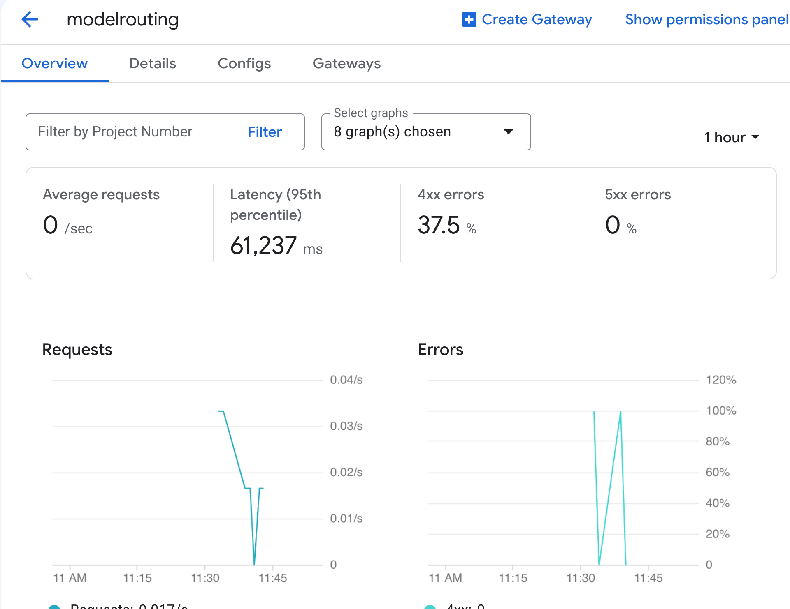

Every routed request is written to the API Gateway request log. To find recent requests in Logs Explorer, use this filter:

```text
(resource.type="apigateway.googleapis.com/Gateway" OR resource.type="api")
logName="projects/PROJECT_ID/logs/apigateway.googleapis.com%2Frequests"
```

Or list them from the CLI:

```bash
gcloud logging read \
  "logName=\"projects/${PROJECT_ID}/logs/apigateway.googleapis.com%2Frequests\"" \
  --limit=10 \
  --format="table(timestamp, httpRequest.status, httpRequest.requestUrl)"
```

For traffic and error rates, use the `apigateway.googleapis.com/proxy/request_count` metric (**Beta**) in Cloud Monitoring. You can break it down by `response_code_class` and `api_config`.

When a request fails inside the router, the `responseDetails` field in the log entry tells you where it failed:

| `responseDetails` | Meaning | Typical fix |
| :--- | :--- | :--- |
| `model_router_application_error` | The request couldn't be routed, for example because of a malformed payload or a `model` value that matches nothing. | Check that the body is valid OpenAI-compatible JSON, includes `model`, and matches a rule or falls back to `defaultModel`. |
| `model_router_timeout` | The router exceeded the request timeout. | Check request size and complexity, and the backend `deadline`. |
| `model_router_upstream_error` | The target model returned an HTTP error. | Check the status and payload from the Agent Platform endpoint, such as a model that isn't enabled or a malformed publisher model ID. |
| `model_router_unavailable` | The gateway couldn't reach the router. | Open a support case. |

> **Note:** The request logs don't show which target model handled each request yet. To see it per request, check the `model` field in the response, or test with one rule per endpoint so that the target is unambiguous.

### 4.7 Good to know before production

These limits apply during Public Preview:

| Area | What to know |
| :--- | :--- |
| Routing signal | Routing uses only the `model` attribute of text-based, OpenAI-compatible JSON requests. |
| Hostnames | All backends in a router must share one hostname and scheme: the global endpoint or a single regional endpoint. |
| Spec format | OpenAPI 3.x only (no OpenAPI 2.0). You can't mix model routing with `x-google-backend` operations or MCP in one API config. |
| Existing gateways | You can't turn model routing on or off for an existing gateway. Create a new API config and a new gateway instead. |
| Networking | VPC Service Controls and Private Service Connect aren't supported. Streaming gateways can't sit behind a load balancer, so custom domains aren't supported yet. |
| Protocols | Response streaming (SSE) is supported. Request streaming, gRPC, WebSockets, and Gemini Live aren't. |
| Timeouts and cold starts | Requests time out after at most 3,600 seconds. If a gateway scales to zero, the next request can see cold-start latency. |

A short checklist before you send real traffic:

* **Lock it down.** Keep the API key requirement, restrict keys to your API, and use JWT authentication for stronger identity checks.
* **Use least privilege.** The gateway service account needs only `roles/aiplatform.user`.
* **Set `deadline` deliberately** for each backend, based on the longest response you expect.
* **Version your configs** (`cfg-v1`, `cfg-v2`, and so on) so that rolling forward or back is a single `gateways update`.

### 4.8 Clean up

When you're finished, delete what you created:

```bash
gcloud api-gateway gateways delete "${GATEWAY_ID}" --location="${REGION}"
gcloud api-gateway api-configs delete "${CONFIG_ID}" --api="${API_ID}"
gcloud api-gateway apis delete "${API_ID}"
gcloud services api-keys delete "${KEY_ID}"
gcloud iam service-accounts delete "${SA_EMAIL}"
```

---

## 5. Conclusion

Model routing turns API Gateway into a managed, OpenAI-compatible front door for Model Garden. Your clients learn one API, your platform team decides in a single OpenAPI spec which model serves each request, and Google runs the infrastructure.

Google Cloud's model lineup makes this especially useful. It's the only hyperscaler that offers all three leading closed-source LLM families, alongside more than 200 other models. You can pick the best model for each task today and change your mind later without touching client code.

The console, gcloud, and the Antigravity CLI all create the same three resources: an API, an API config, and a gateway. Start with one router and a sensible default model, then add rules as you evaluate new models. Keep an eye on the release notes as the Public Preview expands.

### What's next

* **Read the docs:** [Overview of model routing](https://docs.cloud.google.com/api-gateway/docs/model-routing-overview) and [Configure model routing](https://docs.cloud.google.com/api-gateway/docs/model-routing-configure).
* **Explore the spec extensions:** [OpenAPI 3.x extensions in API Gateway](https://docs.cloud.google.com/api-gateway/docs/oasv3-extensions).
* **Secure and tune your gateway:** [Use API keys](https://docs.cloud.google.com/api-gateway/docs/authenticate-api-keys) and [Configure streaming](https://docs.cloud.google.com/api-gateway/docs/streaming-configure).
* **Browse models:** [Claude on Google Cloud](https://docs.cloud.google.com/gemini-enterprise-agent-platform/models/partner-models/claude), [open models on Agent Platform (MaaS)](https://docs.cloud.google.com/gemini-enterprise-agent-platform/models/maas/use-open-models), and [OpenAI models on Google Cloud](https://cloud.google.com/blog/products/ai-machine-learning/google-cloud-brings-openai-models-to-customers).
* **Try the agentic path:** [Get started with the Antigravity CLI](https://antigravity.google/docs/getting-started).
* **Stay current:** [API Gateway release notes](https://docs.cloud.google.com/api-gateway/docs/release-notes).

---

*Opinions are my own and not the views of my employer.*
