# API Gateway を活用した Google Cloud でのモデルルーティング

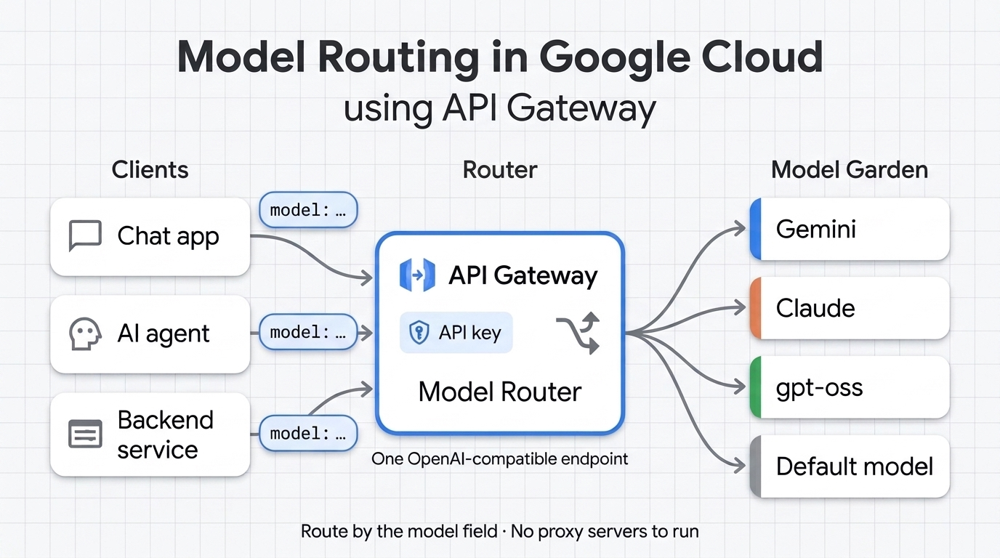

現在の本番環境における AI システムの多くは、もはや単一のモデルだけでは動作していません。たとえば、計画立案には最先端の推論モデルを使い、要約には高速かつ低コストなモデルを使い、さらにフォールバック用として別のプロバイダを用意しておくといった構成が一般的になっています。しかし、モデルプロバイダごとに独自の API 仕様が存在するため、実際にこれらを組み合わせようとすると、コード内に複数の SDK が乱立（SDK スプロール）したり、自前でプロキシサーバーを構築して運用・スケール・セキュリティ対策まで抱え込んだりすることになりがちです。

本記事では、**API Gateway のモデルルーティング**（**Public Preview**）について解説します。これは、個々の API 実装の違いをほとんど意識することなく、エンドポイントや指定を切り替えるだけで目的のモデルへ API コールをルーティングできるマネージド機能です。単一の OpenAI 互換 API コールを作成するだけで、API パスを切り替えて Model Garden 上の Gemini、Anthropic、OpenAI をはじめとする多様な AI モデルへシームレスにアクセスできます。

## モデルルーティングとは何か、なぜ必要なのか

### 課題：多様なモデルと乱立する API

Gemini Enterprise Agent Platform（旧 Vertex AI）では、モデルファミリーごとに固有のエンドポイントとリクエスト形式が用意されています。

* **Google Gemini**：Gemini リクエスト形式
* **Anthropic Claude**：Anthropic Messages リクエスト形式
* **OpenAI 互換の MaaS モデル（`gpt-oss` など）**：OpenAI Chat Completions リクエスト形式

アプリケーションからこれら 3 つすべてを利用する場合、3 通りのコードパスを実装する必要があります。その結果、開発チームは多くの場合、次のいずれかのパターンに陥ります。

* **SDK の乱立（SDK スプロール）**：すべてのアプリケーションに複数の SDK を組み込むパターンです。モデルを切り替えるたびにコード変更と再デプロイが必要になります。
* **LiteLLM などのセルフホスト型プロキシ**：クライアントから見る API は 1 つに統一できますが、新たにプロキシサービスを自前でホストし、スケーリング、パッチ適用、セキュリティ確保まで運用し続ける負担が発生します。

[API Gateway のモデルルーティング](https://docs.cloud.google.com/api-gateway/docs/model-routing-overview)は、こうした課題を解決するマネージドなトラフィック管理レイヤーです。OpenAI 互換のプロンプトリクエストを受け取り、通信の途中で（インフライトで）対象モデルの形式へ変換したうえで、Model Garden 内の特定のモデルへとルーティングします。サードパーティ製のルーターも存在しますが、Google Cloud をベースにインフラを構築しているのであれば、Google Cloud ネイティブのモデルルーティングを利用することで、手間のかからない標準統合された体験をすぐに得ることができます。

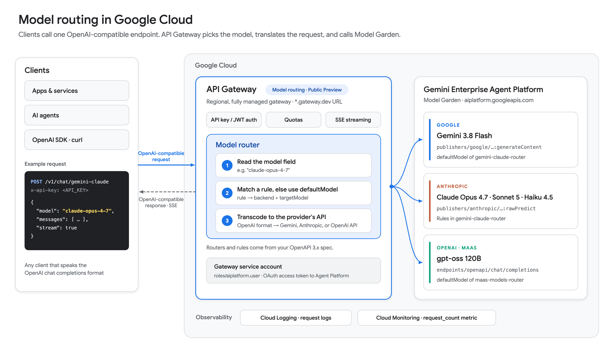
*図1: API Gateway を経由してクライアントリクエストを Model Garden 内の各 LLM プロバイダへルーティングするアーキテクチャ図*

## なぜ Google Cloud のモデルルーティングなのか

モデルルーターの有用性は「どのモデルに到達できるか」によって決まりますが、まさにこの点において Google Cloud は際立った強みを持っています。現在 Google Cloud は、主要な 3 大クローズドソース LLM すべてへのアクセスを提供している唯一のハイパースケール クラウドプロバイダであり、さらに 200 種類以上のファーストパーティ、サードパーティ、およびオープンモデルを統合されたエンタープライズ AI プラットフォーム上で提供しています。

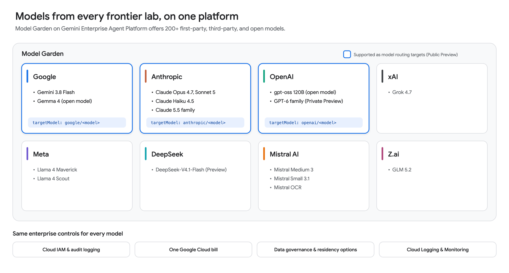
*図2: エンタープライズ AI プラットフォーム上でサポートされている多様なモデルファミリーの概要*

## API Gateway とは

[API Gateway](https://docs.cloud.google.com/api-gateway/docs/about-api-gateway) は、バックエンドサービスの前段に一貫性のあるセキュアな REST API を構築できる Google Cloud のフルマネージドサービスです。OpenAPI 仕様（OpenAPI spec）で API を記述するだけで、API Gateway がそれをホストします。また、認証（API キー、Google ID トークン、その他の JWT）、割り当て（クォータ）、トラフィック管理、ロギング、モニタリングも標準で処理します。

2026 年には、API Gateway に AI 向けの複数の新機能が追加されました（いずれも **Public Preview**）。

* **モデルルーティング（Model routing）**（2026 年 8 月 3 日リリース）：OpenAI 互換のリクエストを Model Garden 内の各モデルへルーティングします。
* **Model Context Protocol (MCP)**（2026 年 9 月 11 日リリース）：既存の REST API を MCP ツールとしてエージェントに公開します。
* **ストリーミング ゲートウェイ（Streaming gateways）**（2026 年 9 月 29 日リリース）：トラフィックをバッファリングせず、ストリーミング（SSE、チャンク転送、WebSocket、gRPC）としてそのまま配信します。

## モデルルーティングの設定手順

ここからは、API Gateway でモデルルーティングを設定する具体的な手順を解説します。

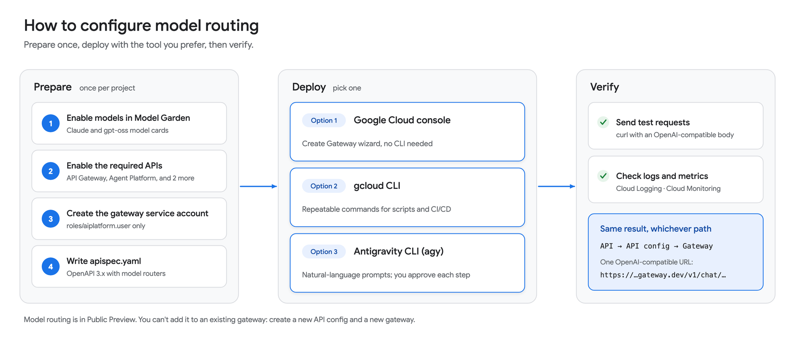
*図3: モデルルーティングの設定およびデプロイのワークフロー*

### 事前準備

#### Step 1: Model Garden でモデルを有効化する

Gemini モデルは Agent Platform API が有効化されていればすぐに呼び出すことができます。一方、Claude などのパートナーモデルや、`gpt-oss` などのマネージド オープンモデルを利用する場合は、事前に Model Garden 上で有効化しておく必要があります。

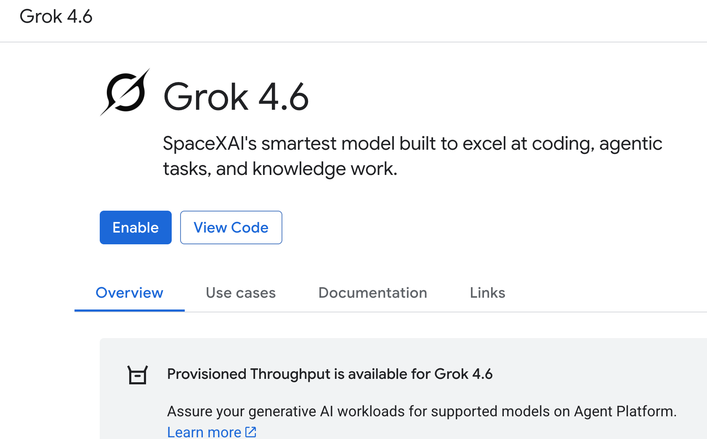
*図4: Model Garden でのパートナーモデル（Grok 4.6 など）の有効化画面*

#### Step 2: 必要な API を有効化する

以下の 4 つの API を有効化します。

* **API Gateway API**（`apigateway.googleapis.com`）：ゲートウェイの作成および実行を行います。
* **Service Management API**（`servicemanagement.googleapis.com`）：API のマネージド サービス構成を保存します。
* **Service Control API**（`servicecontrol.googleapis.com`）：実行時にリクエスト（認証、クォータ、テレメトリ）のチェックを行います。
* **Agent Platform API**（`aiplatform.googleapis.com`）：Model Garden のエンドポイントを提供します。

コンソールから設定する場合は、**APIs & Services > Library**（API とサービス > ライブラリ）に移動し、各 API を検索して **Enable**（有効にする）をクリックします。または、以下のコマンド 1 つで一括有効化することもできます。

```bash
gcloud services enable \
  apigateway.googleapis.com \
  servicemanagement.googleapis.com \
  servicecontrol.googleapis.com \
  aiplatform.googleapis.com
```

#### Step 3: ゲートウェイ用のサービスアカウントを作成する

ゲートウェイから Model Garden（Agent Platform）内のモデルへ API コールを行うための権限が必要になります。これには API Gateway にサービスアカウントを割り当てます。割り当てると、API Gateway はそのサービスアカウントに付与された権限でバックエンドを呼び出すようになります。以下のようにサービスアカウントを作成して権限を付与します。

**gcloud コマンドを使用する場合：**

```bash
# ゲートウェイ専用の ID（サービスアカウント）を作成
gcloud iam service-accounts create "${SA_NAME}" \
  --display-name="API Gateway model router"

# Agent Platform 上のモデル呼び出し権限のみを付与（最小権限）
gcloud projects add-iam-policy-binding "${PROJECT_ID}" \
  --member="serviceAccount:${SA_EMAIL}" \
  --role="roles/aiplatform.user"

# 作業ユーザーが API 構成にこのサービスアカウントをアタッチできるよう権限を付与
gcloud iam service-accounts add-iam-policy-binding "${SA_EMAIL}" \
  --member="user:$(gcloud config get-value account)" \
  --role="roles/iam.serviceAccountUser"
```

**Google Cloud コンソールを使用する場合：**

1. **IAM & Admin > Service accounts** に移動し、**Create service account** をクリックします。
2. 名前に `model-router-sa` と入力し、**Agent Platform User** ロールを付与します。
3. 作成したサービスアカウントの **Permissions** タブを開き、**Grant access** をクリックします。
4. 自分のユーザーアカウントに対して **Service Account User** ロールを付与します。

#### Step 4: OpenAPI 3.x 仕様ファイルを作成する

API パスを定義するため、必要なパスとルーティングルールを記述した OpenAPI 仕様の YAML ファイルを作成します。サポートしたいすべてのモデルに対応するパスやルールを追加できます。以下は、Gemini、Anthropic、OpenAI などのモデルをサポートするサンプルの YAML ファイル（`apispec.yaml`）です。

```yaml
openapi: 3.0.3

info:
  title: OpenAPI 3.x spec using Model Routing
  description: Using Model Routing in an OAS 3.x spec
  version: 1.0.0

x-google-api-management:
  backends:
    gemini-38-flash:
      address: "https://aiplatform.googleapis.com/v1/projects/haren-main/locations/global/publishers/google/models/gemini-3.8-flash:generateContent"
      deadline: 60.0
      pathTranslation: CONSTANT_ADDRESS

    anthropic-claude-opus-47:
      address: "https://aiplatform.googleapis.com/v1/projects/haren-main/locations/global/publishers/anthropic/models/claude-opus-4-7:rawPredict"
      deadline: 60.0
      pathTranslation: CONSTANT_ADDRESS

    anthropic-claude-sonnet-5:
      address: "https://aiplatform.googleapis.com/v1/projects/haren-main/locations/global/publishers/anthropic/models/claude-sonnet-5:rawPredict"
      deadline: 60.0
      pathTranslation: CONSTANT_ADDRESS

    anthropic-claude-haiku-45:
      address: "https://aiplatform.googleapis.com/v1/projects/haren-main/locations/global/publishers/anthropic/models/claude-haiku-4-5:rawPredict"
      deadline: 60.0
      pathTranslation: CONSTANT_ADDRESS

    vertex-maas-openapi:
      address: "https://aiplatform.googleapis.com/v1/projects/haren-main/locations/global/endpoints/openapi/chat/completions"
      deadline: 60.0
      pathTranslation: CONSTANT_ADDRESS

  ai:
    models:
      routing:
        routers:
          gemini-claude-router:
            defaultModel:
              backend: gemini-38-flash
              targetModel: google/gemini-3.8-flash
            rules:
              - model: "claude-opus-4-7"
                backend: anthropic-claude-opus-47
                targetModel: anthropic/claude-opus-4-7
              - model: "claude-sonnet-5"
                backend: anthropic-claude-sonnet-5
                targetModel: anthropic/claude-sonnet-5
              - model: "claude-haiku-4-5"
                backend: anthropic-claude-haiku-45
                targetModel: anthropic/claude-haiku-4-5

          maas-models-router:
            defaultModel:
              backend: vertex-maas-openapi
              targetModel: openai/gpt-oss-120b-maas
            rules:
              - model: "gpt-oss-120b-maas"
                backend: vertex-maas-openapi
                targetModel: openai/gpt-oss-120b-maas
              - model: "deepseek-v4.1"
                backend: vertex-maas-openapi
                targetModel: openai/deepseek-v4.1-flash-maas
              - model: "grok-4.7"
                backend: vertex-maas-openapi
                targetModel: openai/grok-4.7
              - model: "glm-5.2"
                backend: vertex-maas-openapi
                targetModel: openai/glm-5.2-maas
              - model: "codestral-2"
                backend: vertex-maas-openapi
                targetModel: openai/codestral-2
              - model: "llama-4-maverick"
                backend: vertex-maas-openapi
                targetModel: openai/llama-4-maverick-17b-128e-instruct-maas

servers:
  - url: "https://serving-host-name"

paths:
  /v1/chat/gemini-claude:
    post:
      summary: "Router for Gemini and Anthropic Claude models"
      operationId: "chatGeminiClaude"
      x-google-model-router: gemini-claude-router
      responses:
        "200":
          description: "OK"

  /v1/chat/maas-models:
    post:
      summary: "Router for Vertex AI MaaS OpenAI-compatible models"
      operationId: "chatMaasModels"
      x-google-model-router: maas-models-router
      responses:
        "200":
          description: "OK"
```

### デプロイ：Google Cloud コンソール（Web UI）を使用する場合

1. Google Cloud コンソールの [API Gateway](https://console.cloud.google.com/api-gateway/) ページを開き、**Create Gateway** をクリックします。

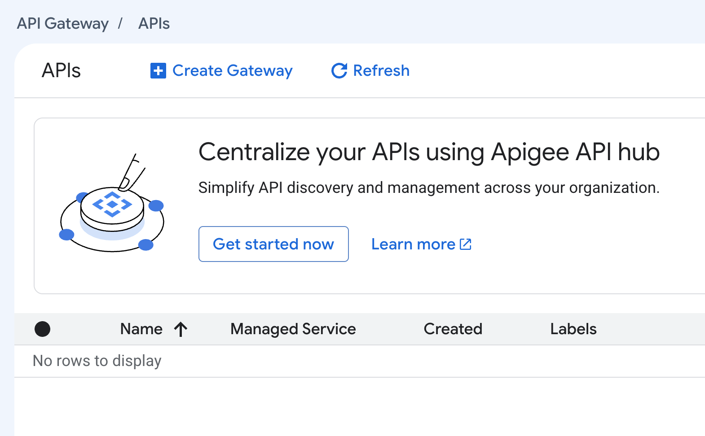
*図5: Google Cloud コンソールの API Gateway メイン画面*

2. **API** セクションで **Create new API** を選択します。表示名（例：`ModelRouting`）と API ID（例：`modelrouting`）を入力します。コンソール上に API のマネージド サービス名のプレビューが表示されます。

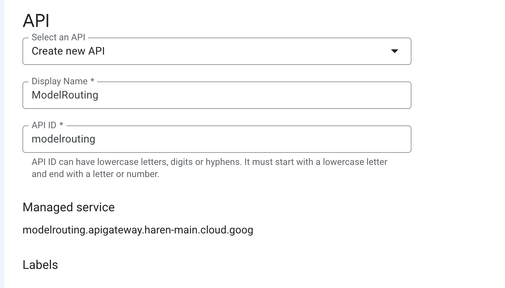
*図6: Cloud コンソールでの API 表示名と API ID の定義*

3. **API Config** セクションで **Create new API config** を選択し、**Browse** をクリックして前のステップで作成した `apispec.yaml` をアップロードします。表示名を入力し、**Select a Service Account** で先ほど作成したサービスアカウント（または必要な権限を持つ既存のサービスアカウント）を選択します。

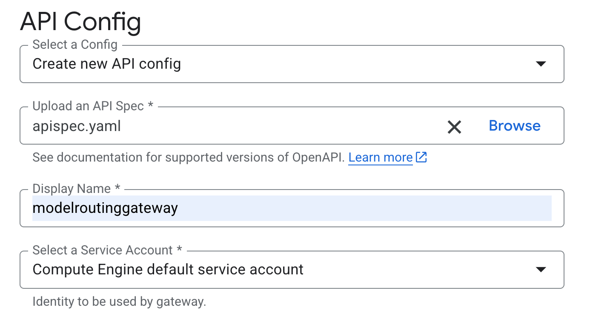
*図7: OpenAPI 仕様ファイルのアップロードとゲートウェイ用サービスアカウントの指定*

4. **Gateway details** セクションで表示名を入力し、ロケーション（例：`us-central1`）を選択して **Create gateway** をクリックします。

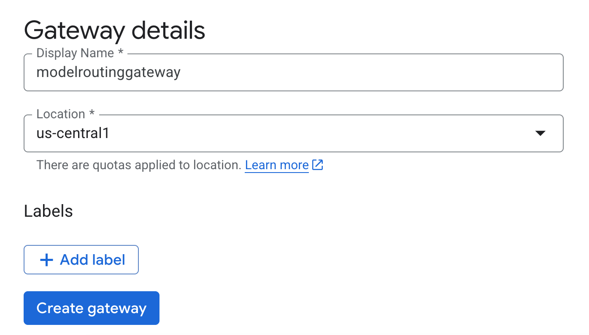
*図8: Cloud コンソールでのゲートウェイのリージョン設定*

5. ゲートウェイの作成には数分かかります。完了すると、API 一覧に作成した API とそのマネージド サービス名が表示されます。

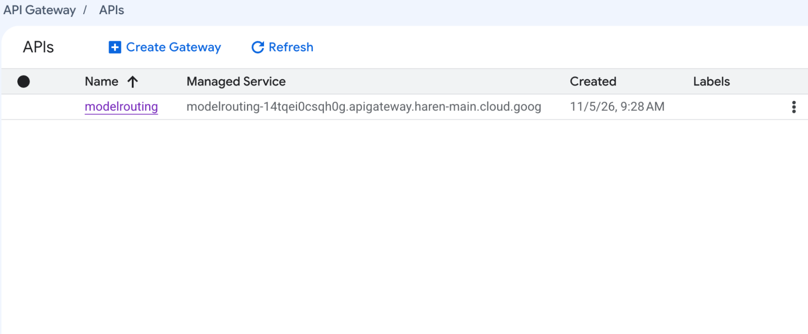
*図9: 新たに作成され有効化された API とマネージド サービス エンドポイントの表示*

6. API 名をクリックし、**Gateways** タブを開いてゲートウェイの URL をコピーします。

### デプロイ：gcloud CLI を使用する場合

API、API 構成（API config）、およびゲートウェイを順番に作成します。

```bash
# 1. API（論理コンテナおよび対応するマネージド サービス）を作成
gcloud api-gateway apis create "${API_ID}" --display-name="ModelRouting"

# 2. 仕様ファイルから API 構成を作成（ここで API Gateway によるバリデーションが行われます）
gcloud api-gateway api-configs create "${CONFIG_ID}" \
  --api="${API_ID}" \
  --openapi-spec=apispec.yaml \
  --backend-auth-service-account="${SA_EMAIL}"

# 3. 作成した構成をリージョン ゲートウェイにデプロイ
gcloud api-gateway gateways create "${GATEWAY_ID}" \
  --api="${API_ID}" \
  --api-config="${CONFIG_ID}" \
  --location="${REGION}"
```

ゲートウェイが有効（`ACTIVE`）になったことを確認します。

```bash
gcloud api-gateway gateways describe "${GATEWAY_ID}" \
  --location="${REGION}" \
  --format="yaml(state, defaultHostname, effectiveStreamingMode)"
```

出力は以下のようになります。新しいモデルルーティング対応ゲートウェイでは `gateway.dev` 形式のホスト名が使用される場合があります（従来のゲートウェイでは `run.app` 形式のホスト名が維持されます）。

```yaml
state: ACTIVE
defaultHostname: modelrouting-gateway-PROJECT_NUMBER.us-central1.gateway.dev
effectiveStreamingMode: EFFECTIVE_STREAMING_MODE_ENABLED
```

続いて API キーのサポートを有効化し、この API のみを呼び出せるよう制限した API キーを作成します。

```bash
# API キーが機能するように API のマネージド サービスを有効化
export MANAGED_SERVICE="$(gcloud api-gateway apis describe "${API_ID}" \
  --format='value(managedService)')"
gcloud services enable "${MANAGED_SERVICE}"

# この API のみに制限された API キーを作成
gcloud services api-keys create \
  --key-id="${KEY_ID}" \
  --display-name="Model router client" \
  --api-target=service="${MANAGED_SERVICE}"
```

なお、API 構成（API config）はイミュータブル（変更不可）です。後からルーティング設定を変更したい場合は、新しい構成を作成してゲートウェイの参照先を切り替えます。ロールバックしたい場合も同様に、以前の構成へとゲートウェイの参照先を戻すだけで完了します。

```bash
gcloud api-gateway api-configs create modelrouting-cfg-v2 \
  --api="${API_ID}" \
  --openapi-spec=apispec.yaml \
  --backend-auth-service-account="${SA_EMAIL}"

gcloud api-gateway gateways update "${GATEWAY_ID}" \
  --api="${API_ID}" \
  --api-config=modelrouting-cfg-v2 \
  --location="${REGION}"
```

### デプロイ：Antigravity CLI のプロンプトを使用する場合

[Antigravity CLI](https://antigravity.google/docs/getting-started)（`agy`）は、ターミナル上で動作するコーディングエージェントです。OpenAPI 仕様ファイルの作成から `gcloud` コマンドの実行までを対話的に代行してくれます。デフォルトでは、ファイルの編集やコマンドの実行前にユーザーの承認を求める安全設計になっています。ローカル環境にインストールし、空のフォルダでセッションを開始して利用してください。また、[Google Cloud Shell Editor](https://ide.cloud.google.com/) に標準搭載されている組み込みバージョンをそのまま利用することも可能です。

**プロンプト 1：プロジェクトの準備**

```text
gcloud を使用して、Google Cloud プロジェクト PROJECT_ID を API Gateway のモデルルーティング用にセットアップしてください。
1. apigateway.googleapis.com、servicemanagement.googleapis.com、
   servicecontrol.googleapis.com、aiplatform.googleapis.com を有効化する。
2. model-router-sa という名前のサービスアカウントを作成し、プロジェクトに対して
   roles/aiplatform.user のみを付与する。
3. 自分のユーザーアカウントに対して、そのサービスアカウント上の roles/iam.serviceAccountUser を付与する。
各コマンドは実行前に提示し、エラーが発生した場合はそこで停止してください。
```

**プロンプト 2：仕様ファイルの作成**

```text
https://docs.cloud.google.com/api-gateway/docs/model-routing-configure を読み取り、
プロジェクト PROJECT_ID における API Gateway モデルルーティング用の OpenAPI 3.0.3 仕様ファイル
apispec.yaml を作成してください。
すべてのバックエンドでグローバルエンドポイント https://aiplatform.googleapis.com を使用し、
pathTranslation は CONSTANT_ADDRESS、deadline は 60 秒に設定してください。
- POST /v1/chat/gemini-claude では gemini-claude-router を使用する：デフォルトモデルは
  google/gemini-3.8-flash とし、claude-opus-4-7、claude-sonnet-5、claude-haiku-4-5 については
  それぞれの Anthropic :rawPredict エンドポイントへ振り分けるルールを追加する。
- POST /v1/chat/maas-models では maas-models-router を使用する：デフォルトモデルは
  /endpoints/openapi/chat/completions エンドポイント上の openai/gpt-oss-120b-maas とする。
- すべてのオペレーションで x-api-key ヘッダーによる API キーを必須とする。
保存する前に、該当ページのバリデーションルールに照らしてファイルを検証してください。
```

**プロンプト 3：デプロイ**

```text
gcloud で apispec.yaml をデプロイしてください。API「modelrouting」を作成し、バックエンド認証用
サービスアカウントに model-router-sa を指定した API 構成「modelrouting-cfg-v1」を作成したうえで、
us-central1 にゲートウェイ「modelrouting-gateway」を作成してください。ゲートウェイが ACTIVE に
なるまで待機してから、API のマネージド サービスを有効化し、ゲートウェイの defaultHostname と
effectiveStreamingMode を表示してください。
```

**プロンプト 4：API キーの作成とテスト**

```text
modelrouting のマネージド サービスに制限した、キー ID「model-router-client」の API キーを
作成してください。その後、必ず model フィールドを含めた状態で、ゲートウェイ経由で各ルートに
1 回ずつリクエストを送信してください。
- /v1/chat/gemini-claude に対して claude-opus-4-7 と gemini-3.8-flash
- /v1/chat/maas-models に対して openai/gpt-oss-120b-maas
HTTP ステータス、レスポンスの model フィールド、および各回答の 1 行目を表形式で表示してください。
API キーの文字列そのものは出力しないでください。
```

### モデルルーターのテスト

どの方法でデプロイした場合も、まずはゲートウェイの URL と API キーを環境変数に設定します。

```bash
export GATEWAY_URL="https://$(gcloud api-gateway gateways describe "${GATEWAY_ID}" \
  --location="${REGION}" --format='value(defaultHostname)')"

# コンソールからキーを作成した場合は、代わりにそのキー文字列をここに貼り付けてください
export API_KEY="$(gcloud services api-keys get-key-string "${KEY_ID}" \
  --format='value(keyString)')"
```

**テスト 1：明示的なルールの検証（Claude Opus 4.7）**

```bash
curl -s -X POST "${GATEWAY_URL}/v1/chat/gemini-claude" \
  -H "Content-Type: application/json" \
  -H "x-api-key: ${API_KEY}" \
  -d '{
    "model": "claude-opus-4-7",
    "messages": [
      {"role": "system", "content": "You are a helpful assistant."},
      {"role": "user", "content": "Explain recursion in one sentence."}
    ]
  }'
```

**テスト 2：デフォルトモデルへのフォールバック（Gemini 3.8 Flash）**

```bash
curl -s -X POST "${GATEWAY_URL}/v1/chat/gemini-claude" \
  -H "Content-Type: application/json" \
  -H "x-api-key: ${API_KEY}" \
  -d '{
    "model": "gemini-3.8-flash",
    "messages": [{"role": "user", "content": "Say hello in five words."}]
  }'
```

**テスト 3：OpenAI 互換の MaaS ルート（gpt-oss 120B）**

```bash
curl -s -X POST "${GATEWAY_URL}/v1/chat/maas-models" \
  -H "Content-Type: application/json" \
  -H "x-api-key: ${API_KEY}" \
  -d '{
    "model": "openai/gpt-oss-120b-maas",
    "messages": [{"role": "user", "content": "Say hello in five words."}]
  }'
```

**テスト 4：レスポンスのストリーミング受信**

```bash
curl -N -s -X POST "${GATEWAY_URL}/v1/chat/gemini-claude" \
  -H "Content-Type: application/json" \
  -H "x-api-key: ${API_KEY}" \
  -d '{
    "model": "claude-haiku-4-5",
    "messages": [{"role": "user", "content": "Count from 1 to 5."}],
    "stream": true
  }'
```

### モニタリングとトラブルシューティング

コンソールで対象 API の **Overview** タブを開くと、リクエストレート、95 パーセンタイル（p95）レイテンシ、および `4xx` / `5xx` エラー率をひと目で確認できます。

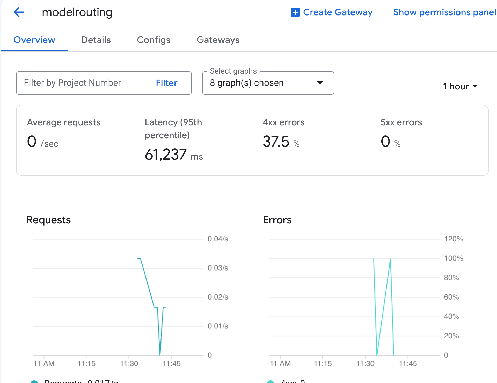
*図10: リクエストトラフィックやエラーメトリクスを表示する API の Overview モニタリングダッシュボード*

## まとめ

モデルルーティングを活用することで、API Gateway を Model Garden 向けのマネージドな OpenAI 互換フロントドアとして機能させることができます。クライアント側は 1 つの API 形式だけを扱えばよく、プラットフォームチームは単一の OpenAPI 仕様ファイル上で「どのリクエストをどのモデルで処理するか」を一元的に制御でき、インフラの運用はすべて Google Cloud に任せることができます。

この仕組みを特に強力なものにしているのが、Google Cloud の充実したモデルラインナップです。主要な 3 大クローズドソース LLM ファミリーすべてに加え、200 種類以上のモデルを単一プラットフォームで提供しているハイパースケーラーは Google Cloud だけです。現時点で各タスクに最適なモデルを選択しておき、将来より適したモデルが登場した際にも、クライアント側のコードを一切変更することなく切り替えることが可能になります。

コンソール、`gcloud`、そして Antigravity CLI のどの手法を使っても、作成されるリソースは「API」「API 構成」「ゲートウェイ」の 3 つに集約されます。まずは 1 つのルーターと適切なデフォルトモデルから小さく始め、新しいモデルの評価を進めながら段階的にルーティングルールを追加してみてください。今後も Public Preview の機能拡充に合わせて、ぜひリリースノートをチェックしてみてください。

### 次のステップ

* **公式ドキュメントを読む**：[モデルルーティングの概要](https://docs.cloud.google.com/api-gateway/docs/model-routing-overview)および[モデルルーティングの設定手順](https://docs.cloud.google.com/api-gateway/docs/model-routing-configure)を確認する。
* **OpenAPI 拡張仕様を確認する**：[API Gateway における OpenAPI 3.x 拡張機能](https://docs.cloud.google.com/api-gateway/docs/oasv3-extensions)の詳細を調べる。
* **ゲートウェイの保護とチューニング**：[API キーによる認証](https://docs.cloud.google.com/api-gateway/docs/authenticate-api-keys)および[ストリーミングの設定](https://docs.cloud.google.com/api-gateway/docs/streaming-configure)を確認する。
* **利用可能なモデルを探す**：[Google Cloud 上の Claude](https://docs.cloud.google.com/gemini-enterprise-agent-platform/models/partner-models/claude)、[Agent Platform 上のオープンモデル（MaaS）](https://docs.cloud.google.com/gemini-enterprise-agent-platform/models/maas/use-open-models)、および [Google Cloud での OpenAI モデルの提供に関する公式ブログ](https://cloud.google.com/blog/products/ai-machine-learning/google-cloud-brings-openai-models-to-customers)を参照する。
* **最新情報を追う**：[API Gateway のリリースノート](https://docs.cloud.google.com/api-gateway/docs/release-notes)をチェックする。
